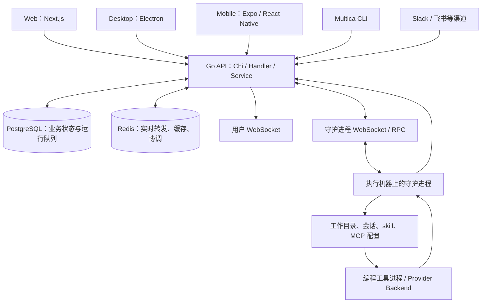
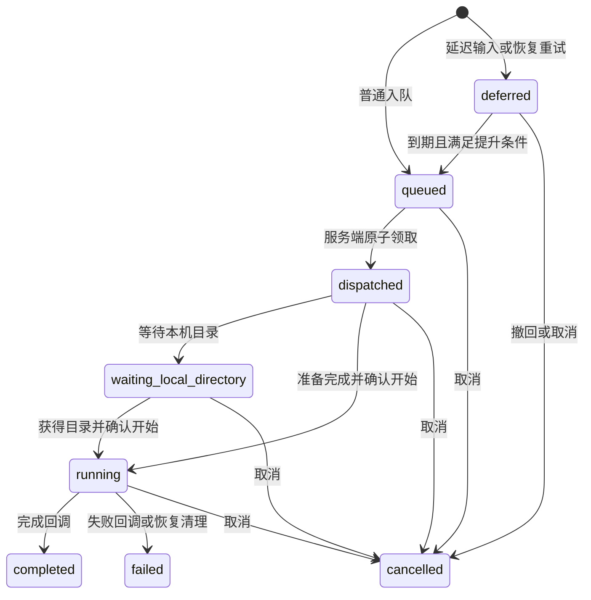

# Multica 实现、调度与权限管理分析报告

分析日期：2026-10-29。分析基线：本地检出的 `b115ec80f`，该提交日期为 2026-10-12。本报告针对这份代码，不代表上游最新版本，也不代表某个线上部署的实际配置。

分析方法：主智能体直接阅读服务端入口、业务服务、SQL、守护进程、提供方适配、共享前端、相关测试与项目文档。正文中的 `[Sxx]` 指向本仓库源码。代码事实、架构判断和需要运行验证的风险分别说明。本次只增加报告，不修改业务实现；没有启动服务、访问业务数据或运行真实智能体。

## 一、核心判断

Multica 的主体是一个把人、任务和本机 AI 编程工具连接起来的协作系统。服务端决定“什么工作可以排队、由谁负责、交给哪个运行时”，机器上的守护进程负责“准备执行环境、启动编程工具、上传结果”。业务数据与队列的权威状态都在 PostgreSQL，WebSocket 用于实时通知和 RPC，Redis 用于跨实例通信及临时协调。[S01][S02][S03][S04]

理解项目时，最重要的是区分以下四件事：

1. **任务与运行是不同对象。** 产品中的任务是 `issue`；一次智能体执行是 Run，API 和数据库仍称为 `task`。任务可以有多次运行，运行也可以只属于聊天或自动化，不关联任务。[S01][S05]
2. **调度由多个层次共同完成。** 触发规则产生运行；数据库协调领取和并发；守护进程分配本机执行槽；定时调度器驱动自动化与唤醒；清理器处理异常状态。[S03][S06][S07][S08][S09]
3. **管理、查看、调用不是同一种权限。** 管理员可以管理一些资源，却不能直接调用他人的私有智能体，也不能使用或公开他人的私有运行时。[S10][S11][S12]
4. **平台权限不等于机器沙箱。** 默认执行进程具有守护进程操作系统用户的文件、凭据和网络访问能力；工作目录与配置分离主要解决执行互不干扰的问题。[S13][S14][S15]

此外，当前代码存在一个应优先处理的权限一致性问题：HTTP 把聊天视为创建者私有，但包含正文的聊天事件仍经工作区广播发送。该结论来自完整的静态调用链，尚未通过双账号运行实验验证，详见第九节。[S28][S29][S30][S31][S32]

## 二、系统架构与模块职责

### 2.1 整体结构

Web、桌面、移动端和 CLI 最终都进入 Go 服务。Web 层还承担请求代理和页面路由；桌面主进程管理本地 CLI 与守护进程；真正的运行队列、工作区检查和业务写入集中在 Go 服务端。Redis 为可选部署组件，但多实例能力依赖所启用功能对应的共享协调设施，不能把单实例的进程内替代实现直接理解为集群等价实现。[S01][S02][S03][S17][S44]

### 2.2 目录与依赖方向

| 位置 | 实际职责 | 主要边界 |
| --- | --- | --- |
| `server/cmd/server/` | 组装依赖、路由、事件监听器、后台 worker | 应用组合入口 |
| `server/internal/handler/` | 输入解析、身份与资源权限检查、HTTP 响应 | 网络与业务边界 |
| `server/internal/service/` | 入队、领取、状态变化、归因、自动化等业务流程 | 跨查询与事务协调 |
| `server/pkg/db/queries/` | 手写 SQL | 真正的数据库筛选、锁与 CAS 条件 |
| `server/pkg/db/generated/` | sqlc 生成代码 | SQL 的类型化调用层 |
| `server/internal/daemon/` | 注册运行时、领取运行、执行、恢复、清理 | 服务端与执行机器之间的边界 |
| `server/pkg/agent/` | 各编程工具的启动与协议适配 | 统一流式消息与结果 |
| `server/internal/scheduler/` | 定时执行计划、租约、重试与审计 | 周期性平台工作 |
| `packages/core/` | API、Query、Zustand、权限规则与平台适配接口 | 无业务 UI 的共享逻辑 |
| `packages/views/` | Web 与 Desktop 共享业务界面 | 依赖 core 与 ui |
| `packages/ui/` | 基础组件与样式 | 不依赖业务层 |
| `apps/mobile/` | 独立移动端 UI、状态、请求与实时同步 | 主要共享类型和纯函数 |

这里的分层不是“每个 handler 只转调一个 service”那么严格：资源访问控制大量留在 handler，service 承担事务和后台调用需要的检查，SQL 再负责关键的竞争条件。因此理解某个操作是否安全，必须一起看路由、中间件、handler、service 和 SQL。[S01][S02][S06][S10][S16]

### 2.3 前端状态和接口兼容

TanStack Query 保存服务端数据；Zustand 保存筛选、草稿、弹窗、布局等客户端状态。工作区身份以路由为准，平台层提供请求头和存储命名空间所需的镜像；WebSocket 则更新或失效 Query 缓存。[S01][S18]

API 边界通过 Zod 和 `parseWithFallback` 处理响应。它允许较新服务端与已安装的旧桌面客户端继续协作，校验失败时记录日志并返回可渲染的默认值。这是显示兼容机制，最终授权仍由服务端决定。[S19][S20]

## 三、核心对象与持久化模型

### 3.1 对象关系

| 对象 | 代表什么 | 对执行的意义 |
| --- | --- | --- |
| Workspace | 团队与数据归属范围 | 成员资格和主要租户边界 |
| Member | 用户在工作区中的成员记录 | 提供 `owner/admin/member` 角色 |
| Agent | 有身份、指令、配置、所有者的智能体 | 被调用的业务执行者，通常绑定一个 runtime |
| Runtime | 某工作区内可使用的编程工具运行实例 | 记录 provider、机器、所有者、可见性和健康状态 |
| Daemon | 运行在机器上的守护进程 | 一个 daemon 可以管理多个 runtime |
| Runtime Profile | 某工具的启动配置 | 支持相同或不同 provider 的独立启动配置 |
| Issue | 用户提交与跟踪的一件工作 | 可以分配给成员、智能体或小队 |
| Run / `agent_task_queue` | 一次具体执行 | 保存生命周期、执行归属、会话、失败、重试和来源 |
| Squad | 人与智能体组成的小队 | 自动执行时解析到 leader，由 leader 协调 |
| Autopilot | 自动化规则 | 由手动、计划或 webhook 等入口触发 |
| Issue Wakeup | 任务上的时间、事件、条件订阅 | 条件成立后产生普通运行，无需常驻等待进程 |

上述关系需要特别注意：负责人 ID 必须与 `assignee_type` 一起解释；runtime 不是整个机器，也不是模型本身；队列表名虽含 queue，却也承载已完成运行的历史记录。[S01][S05][S06][S21][S22][S23]

### 3.2 队列同时承担执行历史和恢复依据

`agent_task_queue` 除了关联 agent、runtime 和可选的 issue/chat/autopilot，还保存优先级、触发评论、线程范围、运行来源、尝试次数、父运行、会话 ID、工作目录、准备租约、失败原因等。重试通常新增一条子运行，保留失败记录和链路，而不是把失败行直接改回 queued。[S05][S06][S24]

仓库规范要求新关系不要依赖新增外键或级联删除，关系检查和清理由应用显式完成。历史迁移仍存在外键，因此不能简单声称“整个数据库没有外键”。分析删除与并发创建时，应以当前迁移序列和应用事务协议为准。[S01][S24][S28]

## 四、一次运行如何产生和执行

### 4.1 任务变更触发

`IssueService.WillEnqueueRun` 是任务写入与触发预览共享的判断入口。创建或更改负责人时，可以产生运行；把已分配任务从固定 `backlog` 状态移出时，也可能产生运行。仅仅修改标题、描述或任意状态，并不都等于重新运行。[S21]

固定 `backlog` 对分配型执行起“停车场”作用；评论触发有独立规则，不能据此断言 backlog 中不会运行。Triage 更严格：队列入口根据 `RunOrigin` 区分从负责人等关系推导出的执行与人明确点名的执行，默认拒绝前者，但明确点名或回复仍有可运行路径。[S21][S25]

### 4.2 评论触发与合并

评论路由的候选来源包括当前负责人、明确提及的智能体、小队 leader、父评论作者和最近会话延续。实际调度还要检查权限、可运行性、已有 pending 输入以及防止自身重复唤醒等条件；它不是“解析到一个 @ 就无条件启动”。预览与真实写入共享触发计算逻辑。[S26]

运行记录区分触发评论、合并评论和已交付评论。领取时记录本轮真正交付的输入，完成后再协调未处理的触发。这个设计用于减少“评论已经产生，但遇到并发、已有运行或响应丢失后没有真正交给智能体”的情况。[S06][S16][S26]

### 4.3 入队

入队主要做以下工作：检查 agent 未归档且绑定 runtime；执行 Triage 守卫；解析人类发起者与责任归因；准备本轮 MCP overlay；写入运行；先发布 queued 事件，再通知运行时有工作可领。顺序如此安排，是为了降低 dispatch 先于 queued 到达客户端造成的状态倒退。[S06][S25]

pending 去重由数据库唯一索引兜底。当前应按较新的迁移理解：任务、智能体和评论线程共同界定 pending 范围；唤醒运行把规则 ID 用作调度范围。不同线程或规则可以有各自待执行输入，但不意味着它们会同时执行。部分旧注释仍使用“每个 issue-agent 只有一条”的简写，不宜用它覆盖较新的 SQL 与迁移事实。[S05][S27]

### 4.4 领取与准备

守护进程先取得本机空闲槽，再发起机器级批量领取。服务端核对 daemon 身份、授权工作区和 runtime 所属机器，忽略未知或不允许的 runtime，避免一个陈旧 ID 使整批领取失败。[S07][S16]

服务端从可领取候选中调度，实际 claim 在事务内锁住 agent，核算其并发容量，再通过带条件的 UPDATE 和 `FOR UPDATE SKIP LOCKED` 把 queued 转为 dispatched。领取后的 payload 构建和交付还会重新核对 runtime 与 agent 绑定，签发运行 token，记录交付输入。[S05][S06][S16]

守护进程随后准备工作目录、仓库、会话、skill 和工具配置。准备阶段还会续租，避免较慢的仓库或配置准备被误判成“领取响应丢失”。环境准备使用独立 helper 子进程，使阻塞的文件系统工作可以被终止；这解决的是准备过程的生命周期控制，并不形成访问沙箱。[S07][S34][S35]

### 4.5 执行与结果

Provider 层通过统一的 `Backend.Execute` 返回 `Session`，提供消息流、最终结果、会话信息以及部分 provider 支持的补充消息或工具活动接口。daemon 消费流式事件、上传日志和用量、监视取消、汇报完成或失败。[S07][S15][S36]

完成与失败路径使用状态条件更新，实现“一个终态转换胜出”。聊天最终回复和会话恢复指针在事务内落库，事件在提交后发布；重复终态回调不应重复写入聊天回复或再次执行外部副作用。daemon 还有落盘的终态报告队列，用于失败回调的后续重试和恢复。[S06][S37]

**运行 completed 不等于任务 done，也不保证任务进入 in_review。** 当前运行简报要求智能体根据工作事实主动维护任务状态；服务端的运行完成路径主要维护执行记录和结果。进入审核、最终验收、PR 合并、部署是不同环节。“人工审核”不能自动理解为底层禁止智能体执行 merge 或部署命令。[S06][S13][S38]

## 五、调度机制详解

### 5.1 运行生命周期

该图展示主路径，并非所有异常转换。清理器还可终结过期 queued、准备超时或失联运行。重试是创建带 `parent_task_id` 的新运行，不能把图里的 failed 理解为会原地回到 queued。[S05][S06][S09][S24]

### 5.2 三层并发限制

| 层次 | 限制内容 | 实现 |
| --- | --- | --- |
| 单个 agent | 不超过自己的 `max_concurrent_tasks` | 锁 agent 行后统计占用并 claim |
| 同一业务会话 | 同一 issue-agent 或 chat-agent 不能重叠执行 | claim SQL 排除 dispatched/running/waiting 竞争运行 |
| 整台机器 | daemon 管理的所有 runtime 共用本机容量 | 机器级信号量，默认 20 个执行槽 |

不同智能体可以同时处理同一任务；同一个智能体也能在自身上限内处理不同任务。`SKIP LOCKED` 负责跳过被占用的候选行，agent 行锁负责防止并发 claim 突破容量，两者不是重复机制。[S05][S06][S07][S08]

本地目录还有额外规则：in_place 执行按规范化真实路径加锁；worktree 模式为运行建立独立工作树，跳过这类共享目录互斥；聊天在特定 in_place 路径上可豁免目录锁，leader 也有专门的目录处理。因此不应承诺“同一目录绝不会出现并发访问”。[S33][S34]

### 5.3 调度顺序和运行时选择

单个 agent 内的 claim SQL 按 `priority DESC, created_at ASC, id ASC` 排序。运行通常在入队时就携带 runtime，后续还要检查 agent 当前是否仍绑定该 runtime。它不是根据机器 CPU、费用或队列长度在所有主机间自由迁移工作的全局调度器。[S05][S06]

机器级批量入口还会受候选 runtime/agent 遍历和可用槽影响。当前 handler 从 map 构造 runtime 集合，代码自己也指出顺序尚未完全确定。因此可以确认局部优先级规则，却不能宣称整个集群具备严格全局优先级、公平调度或饥饿消除保证。[S16]

### 5.4 WebSocket 与轮询共同保证可达性

daemon 优先使用支持的 WebSocket RPC 领取，同时保留 HTTP 和定时轮询路径。健康 WS 连接且本次响应支持调度提示时，才使用较长的安全轮询间隔；否则使用普通间隔。WS 请求可能已被服务端执行却未收到响应时，也有专门的不确定性恢复处理。[S07][S08][S39]

默认参数不能混淆为统一超时：

| 参数 | 本基线默认值 | 含义 |
| --- | --- | --- |
| 普通领取轮询 | 30 秒 | 兼容与失败回退路径 |
| 健康 WS 安全轮询上界 | 3 分钟 | 实际采用向下随机抖动，且可被下一条 deferred 输入提前 |
| daemon 心跳 | 15 秒 | 报告 runtime 存活 |
| 可领取的 DB 心跳新鲜度 | 150 秒 | 防止仅标记 online 的旧 runtime 领取 |
| 丢失领取响应恢复窗口 | 90 秒 | 重新回收尚未开始的 dispatched 领取 |
| 准备租约 | 45 秒 | daemon 准备期间需要续期 |
| 服务端异常扫描 | 30 秒 | 处理过期、失联与超时状态 |
| runtime 断线运行宽限 | 3 小时 | 默认不会刚显示 offline 就终止本地运行 |
| dispatched 超时阈值 | 300 秒 | 结合准备租约等条件判定，不是简单定时强杀 |
| daemon 绝对运行时长限制 | 0 | 默认不设置总时长上限 |
| 通用无活动 watchdog | 2 小时 | provider、工具活动与其他细分 watchdog 另有规则 |

来源分别为服务端 claim 常量、daemon 配置和 runtime sweeper。运行时长还受具体 provider 的握手、无进展和取消期限影响；健康且持续心跳的长运行不能只根据 9000 秒这一服务端兜底常量判定必然失败。[S06][S08][S09]

最新基线还处理了机器休眠问题：通用 watchdog 使用 awake clock，避免把电脑休眠时间全部计为智能体无输出；已有对应回归测试。[S36][S40]

### 5.5 重试与断线恢复

自动重试只对白名单原因生效，包括 runtime offline/recovery、部分 timeout、Codex semantic inactivity、provider network 和 skill bundle unavailable。业务编译失败、一般模型错误、环境准备问题不会一概自动重试。[S06][S41]

通用 `max_attempts` 默认是 2，包含第一次运行；设置为 1 可关闭自动重试。provider network 有特殊的最多三次尝试策略：一次原始运行、一次立即重试、最后一次约 5 秒后重试；显式关闭重试仍会被尊重。runtime offline 的子运行先进入 deferred，恢复提升受心跳健康条件控制。[S06][S24]

恢复还包括：重新领取响应丢失的 dispatched 运行；daemon 重启后处理孤儿运行；取消后冲洗消息并确认；终态回调落盘重放；自动重试前检查是否已有后继运行。已有运行会话不安全时，会退役对应会话或使用 fresh session，工作目录则尽量保留可继续的成果。[S06][S07][S09][S16][S37]

这些机制提供的是可恢复的执行协调。它们不意味着运行中的 Git、云 CLI 或第三方 HTTP 操作具有端到端 exactly-once 语义：业务工具的副作用仍需自身幂等键、状态查询或人工判断。[S06][S15][S37]

### 5.6 独立的数据库定时调度器

`scheduler.Manager` 默认每 30 秒 tick，启动立即执行一次。它以数据库时间计算计划，用 `(job_name, scope_kind, scope_id, plan_time)` 唯一键竞争执行权，在 `sys_cron_executions` 中记录 RUNNING/SUCCESS/FAILED、attempt、runner、lease token 和心跳。续租与终态写入都检查 lease token，旧执行者不能覆盖新租约的审计状态。[S03][S23][S42]

计划支持 `latest_only` 与 `every_plan`，也允许 job 自己提供 `PlansForScope`；是否补历史计划、补多少、多久超时和如何重试，都由 JobSpec 明确控制。目前注册了用量汇总、搜索变更清理、任务唤醒、子任务事件清理、自动化计划和插件计划等工作。[S03][S23]

此调度器在单个 Manager 内按循环同步执行 job/scope/plan，并不是通用的并行 worker 池。多副本靠数据库 claim 竞争；单个慢 handler 仍可能推迟同进程其他 job。[S23]

另一个应改进的细节是：心跳协程发现 `ErrLeaseLost` 后仅记录日志并退出，没有直接取消 handler 的 `runCtx`。终态 fencing 能保护审计行，却不能自动停止旧 handler 的外部副作用；第九节给出建议。[S23][S42]

### 5.7 自动化 Autopilot

自动化支持 `create_issue` 与 `run_only` 两种执行方式。前者生成可跟踪任务并安排执行；后者直接产生运行，不要求先有 issue。分配给小队时解析其 leader。[S22]

定时触发按 trigger 的 cron 与时区算出 UTC 计划时间；每个 trigger 是独立 scope，折叠漏过的时刻，代码设定约 5 分钟的可接受迟到窗口，不会无限回放历史。调度审计唯一键与业务侧 `(trigger_id, planned_at)` 幂等共同限制重复派发。[S43]

手动“立即运行”按实际点击者或其可信上游人类判断权限；schedule/webhook 按触发器记录的创建者解析执行 principal。检查调用权限与记录运行来源使用同一个 principal，避免“按 A 的权限放行，却以 B 的身份运行”。离线但可恢复的机器可以接受 `create_issue`，无法执行的坏 runtime 与 `run_only` 则有不同准入处理。[S22]

### 5.8 任务唤醒与小队协调

Issue wakeup 保存 at/every/cron、事件或条件配置。条件涵盖状态、子任务、关联 PR 等平台可读取的事实；满足后生成普通运行，不保持一个等待中的模型进程。规则 revision 写入运行 context，claim 时再次核对规则、issue、agent、创建者和调用权限，旧配置不能继续生效。[S45][S46][S47]

规则还具有限流、循环和次数保护：非手动的事件规则适用每小时运行阈值 12 及循环暂停检查；定时规则由自身间隔和截止条件约束，手动“立即唤醒”不受上述事件规则保护限制。另有默认重复触发上限 20、触发链长度限制 32 等约束；子任务完成的系统规则有专门行为，不能把普通规则的所有默认值直接套上去。规则可以把证据并入已有、同一授权人名下的待执行运行，或识别已经被当前智能体处理的事实，降低重复运行。[S45][S46][S48]

小队 leader 通过简报获得成员名单和协调协议，使用评论提及或子任务安排工作，派发后结束本轮，之后再由评论或子任务阶段变化唤醒。这是“规则、数据记录和模型协调”结合的协作方式；简报里的职责限制本身不等于操作系统或工具调用层的强制禁止。[S26][S49][S50]

## 六、权限管理模型

### 6.1 认证凭据各有用途

| 凭据 | 入口与身份 | 主要约束 |
| --- | --- | --- |
| JWT / `multica_auth` cookie | 人的交互会话 | cookie 写请求需要 CSRF；支持滑动续期 |
| `mul_` PAT | 用户的 CLI/程序访问 | token 哈希查询，缓存与失效机制 |
| `mdt_` daemon token | 守护进程协议 | 绑定 workspace 与 daemon 身份 |
| `mat_` task token | 执行中的智能体访问平台 | 绑定 user、agent、task、workspace，当前领取签发 24 小时有效期 |
| `mcn_` cloud node PAT | 云节点代表用户访问 | 由 Cloud 验证；未配置验证器则拒绝 |
| `mpi_` / `mpc_` | 插件安装与回调访问 | 独立 Action API 凭据和授权范围 |

普通 Auth 与 DaemonAuth 是两条不同中间件链。`mdt_` 不能简单当成人的完整 API token；`mat_` 也不能当作可登录交互会话的凭据。[S02][S04][S16][S51][S52]

Auth 会先删除客户端传来的 `X-Actor-Source`、`X-Agent-ID`、`X-Task-ID`，再根据已验证 token 写入可信身份。否则成员只要获知一组运行和智能体 ID，就可能伪装成该智能体。任务 token 路径还强制使用 token 绑定的工作区，不能通过 slug、query 或 URL 参数切换租户。[S04][S53]

PAT 与 daemon token 缓存默认 TTL 为 10 分钟，写入时受凭据剩余有效期限制；撤销路径主动失效缓存，但失效失败时仍受 TTL 窗口影响。JWT 会话则没有服务端会话记录来提供全面即时撤销，当前实现明确记录了这个限制。[S51][S54]

### 6.2 工作区角色

角色体系是工作区级 RBAC，再叠加资源所有权和调用白名单。大致规则如下，不能用这张概览替代具体 handler：

| 操作 | 普通 member | admin | owner |
| --- | --- | --- | --- |
| 访问普通工作区协作资源 | 有成员资格并通过资源检查 | 同左 | 同左 |
| 修改工作区设置、管理成员 | 通常不允许 | 允许，角色变更另有矩阵 | 允许 |
| 删除工作区 | 不允许 | 不允许 | 允许 |
| 管理他人的智能体 | 不允许 | 通常允许 | 通常允许 |
| 调用他人的 private 智能体 | 不允许 | 不允许 | 不允许 |
| 使用他人的 private runtime | 不允许 | 不允许 | 不允许 |
| 把他人的 private runtime 公开 | 不允许 | 不允许 | 不允许 |

路由的工作区中间件先确认成员或角色；资源 loader 继续验证实体属于所选工作区，并对无权访问的资源经常返回 404，减少资源存在性的暴露。前端也有镜像规则用于按钮和提示，但它不是最终安全边界。[S02][S10][S11][S12][S20][S53]

### 6.3 智能体的查看、管理与调用

查看 private agent 时，所有者、工作区 owner/admin 有权限，可信 agent actor 也有独立的查看放行。调用则使用更严格的 `canInvokeAgent`：[S10]

- 所有者可以调用自己的智能体。
- `private` 只允许所有者；未知模式默认拒绝。
- `public_to` 按 `agent_invocation_target` 放行。
- workspace target 允许该工作区成员；member target 只允许指定用户。
- team target 在当前版本是保留项，不产生授权。
- 管理员身份没有私有智能体调用豁免。

修改调用范围同样是 owner-only。非所有者管理员传入权限字段会被忽略，避免管理员先给自己加白名单再调用。需要注意，这限制的是特定调用授权字段；管理员仍具有其他治理权，不能据此把管理员视为完全接触不到智能体配置和秘密的角色。[S11][S55]

### 6.4 A2A 按最上游人类授权

假设用户 U 调用了智能体 A，A 又提及 B：调用 B 时不能只认 A 是“工作区内智能体”，而是检查 U 是否能调用 B。这样 A 不能替 U 获得原本没有的 member 白名单权限。[S10][S26]

这是明确的调用链授权，与审计归因相互关联但不相同：`originator_user_id` 是授权值，`accountable_user_id` 是可追溯的人类责任归属；`originator_source` 等字段说明来源，不直接决定权限。缺少精确发起者时，允许的 owner fallback 只补审计责任，不会把空 originator 改成 owner 的授权身份；严格工作区可以拒绝这种降级归因。[S06][S56]

例外也要说明：无明确人类来源的 agent/system 对 `public_to workspace` 目标有产品定义的放行，但不会因此匹配指定成员授权。已终态运行不能继续取用其原有 originator 发起新委派；这项检查用于补强终态 token 撤销失败时的窗口。[S10]

### 6.5 三种容易混淆的人类身份

| 身份 | 当前用途 | 不应混同为 |
| --- | --- | --- |
| 运行 originator | 谁授权这条调用链、A2A 可以调用谁 | 执行机器主人 |
| agent owner | 谁拥有智能体及其开放的 Composio 连接 | 每次运行的点击者 |
| runtime owner | 谁提供执行机器；领取时 task token 的 `user_id` 来源 | 被委派链的最上游人类 |

当前交付事务锁住 runtime 后，以其最新 owner 作为 task token 的 user 身份，同时绑定独立的 agent/task/workspace。Composio overlay 则使用 agent owner 的连接与 toolkit allowlist；originator 不决定连接属于谁。因此把某台机器公开、把某个智能体开放调用，都是对本机或第三方能力的实质授权。[S16][S56][S57]

### 6.6 运行时权限与 daemon 信任

private runtime 只允许其所有者绑定或迁入 agent；public runtime 可供工作区成员使用；ownerless runtime 不能作为可用的绑定目标。服务端交付时会再次锁 runtime 和 agent，确认绑定未改变，private runtime 的所有者与 agent owner 匹配，且 runtime 有有效 owner，缩小检查后配置变化的竞争窗口。[S12][S16]

daemon 是受信任的执行节点。机器级批量 claim 有 daemon ID 和 runtime 归属核对；但 `requireDaemonTaskAccessWithWorkspace` 等公共 helper 主要验证工作区，而非普遍逐次验证调用者就是该 task 的原始执行机器。各端点还可能有额外检查，不能由某个 helper 推断全部接口已被攻破；不过也不能把工作区内不同 daemon token 理解为已经全面相互隔离的零信任凭据。[S16][S52]

### 6.7 环境变量、秘密与人类专属操作

智能体环境变量有单独的管理接口，拒绝识别出的机器凭据 actor，只允许 agent owner 或工作区 owner/admin。明文 reveal 必须成功写入审计，否则拒绝返回；更新和审计在事务内完成。普通 agent 响应对这些值进行掩码，`****` 作为保留原值的保存标记。[S11]

这属于访问控制、掩码与审计，不能据此声称 `custom_env` 已做字段级静态加密：该更新路径把 JSON 写入数据库，本报告未发现这条路径调用加密组件。其他集成存在 secretbox 不能证明所有秘密都统一加密。[S11]

账户账单、部分运行补充操作等路由使用 `RequireHumanActor`，拒绝 `mat_` 和 `mcn_`。由于它按服务器写入的 actor source 判断，不能靠去掉 agent ID 伪装成人；但未知的新机器凭据类型需要在接入认证时同步归类，当前实现不是对所有未知来源一律拒绝。[S02][S58]

## 七、本机执行的权限与隔离

Multica 的默认模型是无人值守地驱动本机编程工具。Claude Code 使用 `bypassPermissions`；Codex 在 Linux 和当前 macOS 路径默认使用 `danger-full-access`，Windows 默认同样如此，但显式启用原生 Windows 沙箱时存在保留 `workspace-write` 的专门分支。[S13][S14][S15]

这意味着：

- 能运行某智能体，通常意味着允许它使用执行用户可触达的本机文件和凭据。
- 生成运行级 `CODEX_HOME`、工作目录、skill 与 MCP 配置，可以减少配置污染和误用，却不能阻止进程读取同一用户的其他文件。
- `mat_` 对平台 API 的身份约束，不能阻止同一操作系统用户下的进程读取本机其他凭据。
- in_place 资源直接作用于用户指定目录，worktree 则改变代码工作副本的组织方式；它们都不天然提供系统调用或网络隔离。
- leader 的“只协调”、agent identity 的职责和“提交审核”等提示，是模型行为协议；除非另有工具权限或基础设施边界，不能视为不可绕过的强制策略。

因此，对互不信任的团队、客户或敏感项目，应把真正的执行边界放到独立系统用户、容器或虚拟机，并为 Git、云服务和部署能力配置独立凭据。该建议由项目明确的执行模型直接推导。[S13][S14][S33][S38][S49]

桌面渲染器与 daemon 也应分开看：Electron renderer 已启用 Chromium sandbox，保持 contextIsolation/nodeIntegration 的安全默认值，但当前仍设置 `webSecurity: false`，属于有注释和测试记录的迁移债务；这既不代表整个桌面进程都无隔离，也不构成 daemon 子进程的沙箱。[S59]

## 八、实时、集成与插件

### 8.1 事件总线与最终一致性

`events.Bus` 是进程内同步总线：同类型监听器按注册顺序执行，随后执行全局监听器；单个监听器 panic 会被捕获。它不是数据库事务日志，也不是所有事件均有持久化重投的消息队列。[S60]

这种设计让通知、活动记录、自动化同步和前端广播可共用事件，但慢监听器会延长发布链，提交成功与全部副作用完成之间也可能有崩溃窗口。项目对关键流程分别增加恢复机制，例如运行终态队列、唤醒 receipt、子任务事件表等；不应把这些局部恢复机制泛化为所有事件都 exactly-once。[S03][S30][S37][S45][S50][S60]

### 8.2 用户实时与 daemon 实时是两条系统

`realtime` 服务用户客户端，支持工作区、用户和资源 scope，以及 Redis relay；`daemonws` 服务执行节点，承载可领工作通知、心跳和 RPC。前者关注界面同步和访问范围，后者关注执行可达性、身份和恢复，不能用一个 WebSocket 的存在证明另一条链路的权限已经满足。[S01][S02][S17][S39]

用户端 scope authorizer 已实现聊天创建者检查；但当前广播监听器仍把 task/chat 高频事件发到 workspace。授权组件“存在”与实际发送路径“使用它”是两回事。[S29][S30][S31]

### 8.3 消息渠道

通用 channel engine 将平台连接器与业务路由分开。Supervisor 对 installation 竞争连接租约，支持重连、凭据更新以及可选 Redis 租约；Router 的处理顺序包括安装路由、两阶段去重、群聊过滤、身份及成员校验、调用权限、会话建立、消息落库、命令解析和延迟合并执行。[S44]

因此，接入 Slack 或飞书并非另起一套智能体队列；渠道输入最终仍进入相同任务/聊天业务与执行调度。连接租约减少多副本重复接收，消息去重与落库协议则处理输入重放，两者不能相互替代。[S44]

### 8.4 插件权限

插件有显式能力模型：当前 host 支持 issue panel/modal、若干 hook trigger、HTTP/MCP transport 和 skill resource；`sidebar_panel` 等未实现能力在安装时明确拒绝，避免“安装成功但永远不执行”。[S61]

Action API 结合三层检查：安装存在且启用、已批准 scope、原始资源访问权限。浏览器插件通过宿主 bridge 使用当前人的会话；public API 只接受插件 bearer。回调 token 有短有效期和调用上下文，关联 issue 的回调还限制 issue 范围；安装 token 则是需要管理和撤销的常驻能力，不能与临时回调混为一谈。[S62][S63][S64]

HTTP hook 检查 `net:` 授权主机、连接时解析的公网地址，使用签名、超时、响应大小限制与熔断。MCP transport 还需要批准工具 schema digest，安装插件本身不等于批准远端全部工具。[S61][S65]

### 8.5 商业配额不是安全授权

`entitlement` 将 Cloud 的 `issue_count`、`autopilot_runs` 策略转换为 off/observe/enforce。缓存、刷新或策略无效时有明确 fail-open 行为，过期 enforcing 策略会降为观察或关闭；这是配额可用性取舍，不是成员资格、私有智能体或跨租户授权的通用规则。[S66]

有效的 enforce 进入业务事务后，普通数据库错误仍会使事务失败。报告或运维指标应区分“配额服务降级允许业务继续”与“调用权限检查失败仍然放行”，二者安全含义完全不同。[S22][S53][S66]

## 九、已发现的问题与改进优先级

以下优先级是本次架构分析建议，未修改实现，也未进行完整安全渗透测试。

### 9.1 高优先级：私聊的 HTTP 权限与实时发送范围不一致

**已确认的静态证据：**

1. 聊天 HTTP 读取和 scope authorizer 将会话限制在创建者，scope authorizer 也对 chat task 进行创建者检查。[S28][S29]
2. `SendChatMessage` 发布的 `chat:message` 直接携带用户 `req.Content`。[S28]
3. `broadcastChatDone` 发布的 `chat:done` 直接携带模型回复 `msg.Content`。[S32]
4. `registerListeners` 的 personal event 集合只专门处理部分聊天列表事件；上述正文事件走 SubscribeAll，并调用 `BroadcastToWorkspace`。[S30]
5. Hub 按工作区 room 发送，没有在此处按聊天创建者再过滤；已有测试明确要求 task/chat 事件维持 workspace fanout。[S31]
6. task message 上传路径同样发布包含消息详情的 `task:message`，其中也可能包括聊天运行的内容。[S16]

**判断：**同工作区其他已连接成员可能收到私聊正文和工具日志，即使 HTTP 页面不允许他们打开该会话。客户端收到后不展示不能修复服务端已经发送的数据泄漏。代码路径支持这一判断，但本次没有创建双账号和实际 WebSocket 连接来验证部署行为。[S16][S28][S30][S31][S32]

**建议：**优先把私聊正文及其 task transcript 绑定到创建者的用户路由，或补齐客户端订阅后启用已鉴权资源 scope；不能只改 chat:session 列表事件。加入同工作区双成员的负向测试，覆盖用户输入、模型回复、流式工具消息和重连场景。跨实例 relay 也应使用相同接收者约束。

### 9.2 中优先级：定时租约丢失没有直接停止旧 handler

**事实：**`runHeartbeats` 在 `ErrLeaseLost` 时退出，但没有取消 `runClaimed` 中独立创建的 `runCtx`；旧 handler 仍可继续至自身返回或超时。终态 UPDATE 的 token fencing 只能阻止覆盖新审计状态。[S23][S42]

**影响：**接管或失租窗口中，某些 handler 可能产生重复外部副作用。自动化的业务幂等已经缓解一部分路径，不能自动覆盖未来注册的所有 job。[S43]

**建议：**把明确失租信号传回执行上下文；要求每个可重入 handler 在外部操作处使用业务幂等键。把“旧执行者失租后不再新增副作用”作为独立并发测试目标。

### 9.3 中优先级：daemon 权限在不同端点上的细度不一致

**事实：**批量领取验证 daemon/runtime 机器归属，而通用 task access helper 主要检查 workspace。不能据此认定每个 task endpoint 都有相同机器身份强度。[S16][S52]

**建议：**明确同工作区 daemon 是否互相信任；逐个核查开始、日志、完成、失败、取消确认等接口的 runtime/daemon/claim generation 检查。如果产品希望执行节点互相隔离，应形成统一的凭据绑定检查，不应只依赖批量 claim 入口。

### 9.4 架构边界：无人值守执行与敏感机器共享

这是已声明的产品模型，不是未披露的沙箱漏洞。public runtime 会把本机执行能力提供给其他成员；开放 agent 调用可能同时开放 agent owner 的第三方连接。风险控制应聚焦执行基础设施、凭据范围及分享行为的解释。[S12][S13][S56][S57]

### 9.5 中长期：调度、公平性与代码可维护性

当前 `TaskService` 主文件约 8,110 行，daemon 主文件约 10,676 行，daemon handler 约 6,115 行。它们集中承载会话恢复、聊天输入、触发、鉴权和 provider 兼容等复杂职责，增加理解、测试选择和修改回归的成本。这里的规模是本基线直接行数统计，不能单独作为质量缺陷结论。

建议在有实际改动需求时，围绕“领取与交付协议”“运行终态事务”“重试与恢复”“会话及执行环境”逐步建立模块边界，并保留已有并发测试。公平性则先明确需求：当前局部优先级不等于全局服务等级保证；只有确实需要跨团队资源竞争时，再引入明确的配额、公平队列与调度指标。[S05][S06][S07][S16][S67]

## 十、阅读入口与验证范围

若后续要修改项目，建议按以下顺序进入代码：

1. `server/cmd/server/main.go` 与 `router.go`：先确认依赖、认证链与 worker 如何装配。
2. `handler/issue.go`、`comment.go`、`service/issue_trigger.go`：理解什么操作真正会触发运行。
3. `service/task.go` 与 `pkg/db/queries/agent.sql`：理解入队、锁、领取、并发与终态。
4. `handler/daemon.go`：理解机器归属、运行 token 与交付事务。
5. `daemon/daemon.go`、`execenv/`、`pkg/agent/`：理解本地执行和恢复。
6. `handler/agent_access.go`、`runtime.go`、`middleware/`：核对授权。
7. `scheduler/`、`service/autopilot.go`、`service/issue_wakeup*.go`：理解持续自动化。
8. `cmd/server/listeners.go`、`realtime/` 与前端实时同步：检查最终数据流是否符合权限。

已阅读的测试覆盖了容量竞争、终态竞争、定时计划竞争、权限矩阵、环境变量访问和休眠 watchdog 等关键行为。测试文件的存在说明项目对此有明确契约，并不等于本次已验证通过。[S31][S40][S67]

本次验证限于静态源码、SQL 与现有测试的交叉核对，以及报告引用和差异检查。当前 shell 找不到 `go`，未执行 Go 测试；未安装依赖、运行数据库、启动 Web/Electron，也未执行真实 agent smoke。尤其第九节的风险优先级，应结合隔离环境中的集成测试进一步确认。

## 源码索引

下列链接定位分析基线下的主要文件和相关起始行；文件后续改动可能导致行号移动。

- [S01] 仓库架构、术语与边界：[AGENTS.md](../../AGENTS.md)、[架构文档](../../apps/docs/content/docs/developers/architecture.zh.mdx)。
- [S02] HTTP 认证与路由装配：[router.go](../../server/cmd/server/router.go#L1556)。
- [S03] 服务端 worker 与 scheduler 装配：[main.go](../../server/cmd/server/main.go#L605)。
- [S04] 普通认证、可信 actor 头和 task token：[auth.go](../../server/internal/middleware/auth.go#L59)。
- [S05] 队列 SQL、串行范围与状态转换：[agent.sql](../../server/pkg/db/queries/agent.sql#L749)。
- [S06] 运行入队、claim、终态、归因与恢复：[task.go](../../server/internal/service/task.go#L1258)。
- [S07] daemon 本机调度与执行：[daemon.go](../../server/internal/daemon/daemon.go#L5377)。
- [S08] daemon 默认参数：[config.go](../../server/internal/daemon/config.go#L23)。
- [S09] 失联、超时与后台清理：[runtime_sweeper.go](../../server/cmd/server/runtime_sweeper.go#L26)。
- [S10] 智能体查看、调用与 A2A 权限：[agent_access.go](../../server/internal/handler/agent_access.go#L13)。
- [S11] 环境变量权限、掩码与审计：[agent_env.go](../../server/internal/handler/agent_env.go#L54)。
- [S12] 运行时使用与公开权限：[runtime.go](../../server/internal/handler/runtime.go#L864)。
- [S13] 项目声明的执行安全边界：[security-model.zh.mdx](../../apps/docs/content/docs/security-model.zh.mdx)。
- [S14] Codex 实际沙箱策略：[codex_sandbox.go](../../server/internal/daemon/execenv/codex_sandbox.go#L68)。
- [S15] provider 接口与 Claude 参数：[agent.go](../../server/pkg/agent/agent.go#L18)、[claude.go](../../server/pkg/agent/claude.go#L1084)。
- [S16] daemon API、批量领取、交付授权与消息上传：[daemon.go](../../server/internal/handler/daemon.go#L1709)。
- [S17] 实时 Hub 与转发：[hub.go](../../server/internal/realtime/hub.go)、[relay_lifecycle.go](../../server/internal/realtime/relay_lifecycle.go)。
- [S18] 前端实时 Query 协调：[use-realtime-sync.ts](../../packages/core/realtime/use-realtime-sync.ts)。
- [S19] 网络响应容错校验：[schema.ts](../../packages/core/api/schema.ts#L15)。
- [S20] 前端权限规则镜像：[rules.ts](../../packages/core/permissions/rules.ts#L10)。
- [S21] 分配、状态与触发预览共享判断：[issue_trigger.go](../../server/internal/service/issue_trigger.go#L79)。
- [S22] 自动化执行、准入与 principal：[autopilot.go](../../server/internal/service/autopilot.go#L1321)。
- [S23] 定时调度器计划与执行循环：[manager.go](../../server/internal/scheduler/manager.go#L112)。
- [S24] 重试元数据与默认值：[055_task_lease_and_retry.up.sql](../../server/migrations/055_task_lease_and_retry.up.sql)。
- [S25] Triage 队列守卫：[task_triage_guard.go](../../server/internal/service/task_triage_guard.go#L43)。
- [S26] 评论触发候选、调用门禁与派发：[comment.go](../../server/internal/handler/comment.go#L1523)。
- [S27] pending 范围：[452_agent_task_pending_thread_unique.up.sql](../../server/migrations/452_agent_task_pending_thread_unique.up.sql)、[516_wakeup_pending_scope.up.sql](../../server/migrations/516_wakeup_pending_scope.up.sql)。
- [S28] 聊天 HTTP 访问及正文事件：[chat.go](../../server/internal/handler/chat.go#L323)。
- [S29] 聊天与运行 scope authorizer：[scope_authorizer.go](../../server/cmd/server/scope_authorizer.go#L50)。
- [S30] personal event 与 workspace 广播选择：[listeners.go](../../server/cmd/server/listeners.go#L83)。
- [S31] 广播实际行为与现有测试：[hub.go](../../server/internal/realtime/hub.go#L504)、[listeners_scope_test.go](../../server/cmd/server/listeners_scope_test.go#L115)。
- [S32] 携带模型回复的聊天完成事件：[task.go](../../server/internal/service/task.go#L7416)。
- [S33] 本地目录模式、路径互斥与豁免：[local_directory.go](../../server/internal/daemon/local_directory.go#L17)。
- [S34] 环境准备与 local worktree：[execenv.go](../../server/internal/daemon/execenv/execenv.go)、[local_worktree.go](../../server/internal/daemon/execenv/local_worktree.go)。
- [S35] 环境准备 helper：[isolation.go](../../server/internal/daemon/execenv/isolation.go#L16)。
- [S36] Session 与活动时钟接口：[agent.go](../../server/pkg/agent/agent.go#L154)。
- [S37] daemon 终态报告持久化：[terminal_report_queue.go](../../server/internal/daemon/terminal_report_queue.go)。
- [S38] 运行简报的任务工作流与状态约定：[runtime_config_sections.go](../../server/internal/daemon/execenv/runtime_config_sections.go#L666)。
- [S39] WS RPC 与不确定请求回退：[wsrpc.go](../../server/internal/daemon/wsrpc.go)。
- [S40] 机器休眠回归测试：[idle_watchdog_suspend_test.go](../../server/internal/daemon/idle_watchdog_suspend_test.go#L68)。
- [S41] 失败分类契约：[classify.go](../../server/pkg/taskfailure/classify.go)、[task.go](../../server/internal/service/task.go#L5239)。
- [S42] 数据库租约与终态 fencing：[db_ops.go](../../server/internal/scheduler/db_ops.go#L56)。
- [S43] 自动化 cron、幂等与迟到窗口：[jobs_autopilot.go](../../server/internal/scheduler/jobs_autopilot.go#L36)。
- [S44] 通用渠道处理与连接租约：[doc.go](../../server/internal/integrations/channel/engine/doc.go)、[router.go](../../server/internal/integrations/channel/engine/router.go#L23)、[redis_lease_store.go](../../server/internal/integrations/channel/engine/redis_lease_store.go)。
- [S45] 唤醒运行与 claim 权限复查：[issue_wakeup.go](../../server/internal/service/issue_wakeup.go#L629)。
- [S46] 唤醒产品及工程契约：[issue-wakeups.md](issue-wakeups.md)。
- [S47] 条件求值：[issue_wakeup_condition.go](../../server/internal/service/issue_wakeup_condition.go#L223)。
- [S48] 唤醒限流、链路和合并：[issue_wakeup_activity.go](../../server/internal/service/issue_wakeup_activity.go#L16)、[issue_wakeup_join.go](../../server/internal/service/issue_wakeup_join.go)。
- [S49] 小队 leader 协调协议：[squad_briefing.go](../../server/internal/handler/squad_briefing.go#L33)。
- [S50] 子任务完成的系统唤醒：[issue_wakeup_system.go](../../server/internal/service/issue_wakeup_system.go)、[jobs_child_done.go](../../server/internal/scheduler/jobs_child_done.go)。
- [S51] token 与交互会话：[jwt.go](../../server/internal/auth/jwt.go)、[session.go](../../server/internal/auth/session.go)、[task_token.sql](../../server/pkg/db/queries/task_token.sql)。
- [S52] daemon token 认证与上下文：[daemon_auth.go](../../server/internal/middleware/daemon_auth.go#L76)。
- [S53] 工作区解析、成员资格及 task token 租户绑定：[workspace.go](../../server/internal/middleware/workspace.go#L108)。
- [S54] PAT 缓存与撤销窗口：[pat_cache.go](../../server/internal/auth/pat_cache.go#L12)。
- [S55] agent 权限 owner-only 更新：[agent.go](../../server/internal/handler/agent.go#L1998)。
- [S56] 授权发起人与审计归因的区别：[attribution.go](../../server/internal/attribution/attribution.go)、[task.go](../../server/internal/service/task.go#L764)。
- [S57] Composio 执行连接的主体：[dispatch.go](../../server/internal/integrations/composio/dispatch.go)。
- [S58] 人类专属操作中间件：[actor_guards.go](../../server/internal/handler/actor_guards.go#L115)。
- [S59] Electron renderer 的实际安全参数：[renderer-web-preferences.ts](../../apps/desktop/src/main/renderer-web-preferences.ts#L16)。
- [S60] 同步进程内事件总线：[bus.go](../../server/internal/events/bus.go#L42)。
- [S61] 已实现插件能力与 MCP 审批要求：[capabilities.go](../../server/pkg/plugincontract/capabilities.go#L26)。
- [S62] Action API 权限叠加：[plugin_action.go](../../server/internal/service/plugin_action.go#L14)。
- [S63] 插件专用 bearer 入口：[plugin_auth.go](../../server/internal/middleware/plugin_auth.go#L12)。
- [S64] 安装 token 与 callback grant：[plugin_token.go](../../server/internal/service/plugin_token.go#L47)。
- [S65] Hook 目标、签名、限流与熔断：[plugin_hook.go](../../server/internal/service/plugin_hook.go#L25)。
- [S66] 商业策略及降级契约：[entitlement/README.md](../../server/internal/entitlement/README.md)、[types.go](../../server/internal/entitlement/types.go#L80)。
- [S67] 关键并发与权限测试：[task_claim_race_test.go](../../server/internal/service/task_claim_race_test.go)、[task_complete_race_test.go](../../server/internal/service/task_complete_race_test.go)、[concurrent_claim_test.go](../../server/internal/scheduler/concurrent_claim_test.go)、[agent_env_permission_test.go](../../server/internal/handler/agent_env_permission_test.go)。

[S01]: ../../AGENTS.md
[S02]: ../../server/cmd/server/router.go
[S03]: ../../server/cmd/server/main.go
[S04]: ../../server/internal/middleware/auth.go
[S05]: ../../server/pkg/db/queries/agent.sql
[S06]: ../../server/internal/service/task.go
[S07]: ../../server/internal/daemon/daemon.go
[S08]: ../../server/internal/daemon/config.go
[S09]: ../../server/cmd/server/runtime_sweeper.go
[S10]: ../../server/internal/handler/agent_access.go
[S11]: ../../server/internal/handler/agent_env.go
[S12]: ../../server/internal/handler/runtime.go
[S13]: ../../apps/docs/content/docs/security-model.zh.mdx
[S14]: ../../server/internal/daemon/execenv/codex_sandbox.go
[S15]: ../../server/pkg/agent/agent.go
[S16]: ../../server/internal/handler/daemon.go
[S17]: ../../server/internal/realtime/hub.go
[S18]: ../../packages/core/realtime/use-realtime-sync.ts
[S19]: ../../packages/core/api/schema.ts
[S20]: ../../packages/core/permissions/rules.ts
[S21]: ../../server/internal/service/issue_trigger.go
[S22]: ../../server/internal/service/autopilot.go
[S23]: ../../server/internal/scheduler/manager.go
[S24]: ../../server/migrations/055_task_lease_and_retry.up.sql
[S25]: ../../server/internal/service/task_triage_guard.go
[S26]: ../../server/internal/handler/comment.go
[S27]: ../../server/migrations/452_agent_task_pending_thread_unique.up.sql
[S28]: ../../server/internal/handler/chat.go
[S29]: ../../server/cmd/server/scope_authorizer.go
[S30]: ../../server/cmd/server/listeners.go
[S31]: ../../server/cmd/server/listeners_scope_test.go
[S32]: ../../server/internal/service/task.go
[S33]: ../../server/internal/daemon/local_directory.go
[S34]: ../../server/internal/daemon/execenv/execenv.go
[S35]: ../../server/internal/daemon/execenv/isolation.go
[S36]: ../../server/pkg/agent/agent.go
[S37]: ../../server/internal/daemon/terminal_report_queue.go
[S38]: ../../server/internal/daemon/execenv/runtime_config_sections.go
[S39]: ../../server/internal/daemon/wsrpc.go
[S40]: ../../server/internal/daemon/idle_watchdog_suspend_test.go
[S41]: ../../server/pkg/taskfailure/classify.go
[S42]: ../../server/internal/scheduler/db_ops.go
[S43]: ../../server/internal/scheduler/jobs_autopilot.go
[S44]: ../../server/internal/integrations/channel/engine/router.go
[S45]: ../../server/internal/service/issue_wakeup.go
[S46]: issue-wakeups.md
[S47]: ../../server/internal/service/issue_wakeup_condition.go
[S48]: ../../server/internal/service/issue_wakeup_activity.go
[S49]: ../../server/internal/handler/squad_briefing.go
[S50]: ../../server/internal/service/issue_wakeup_system.go
[S51]: ../../server/internal/auth/session.go
[S52]: ../../server/internal/middleware/daemon_auth.go
[S53]: ../../server/internal/middleware/workspace.go
[S54]: ../../server/internal/auth/pat_cache.go
[S55]: ../../server/internal/handler/agent.go
[S56]: ../../server/internal/attribution/attribution.go
[S57]: ../../server/internal/integrations/composio/dispatch.go
[S58]: ../../server/internal/handler/actor_guards.go
[S59]: ../../apps/desktop/src/main/renderer-web-preferences.ts
[S60]: ../../server/internal/events/bus.go
[S61]: ../../server/pkg/plugincontract/capabilities.go
[S62]: ../../server/internal/service/plugin_action.go
[S63]: ../../server/internal/middleware/plugin_auth.go
[S64]: ../../server/internal/service/plugin_token.go
[S65]: ../../server/internal/service/plugin_hook.go
[S66]: ../../server/internal/entitlement/README.md
[S67]: ../../server/internal/service/task_claim_race_test.go
