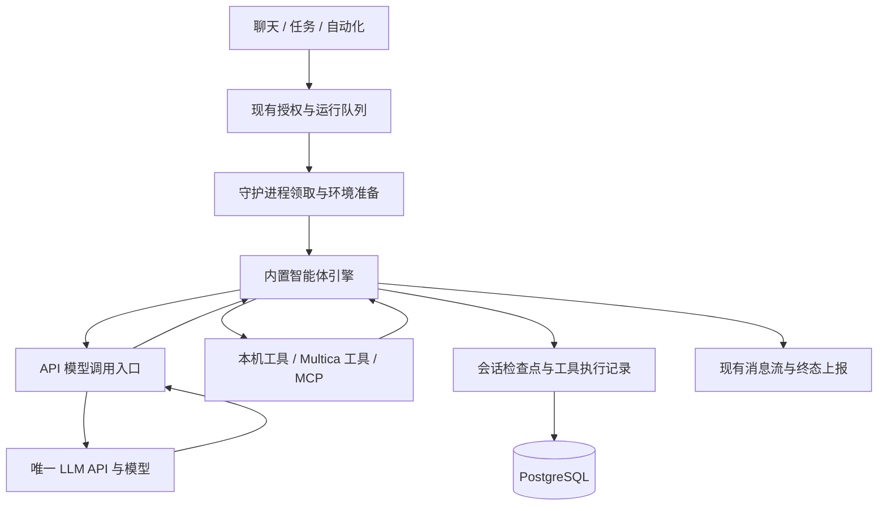
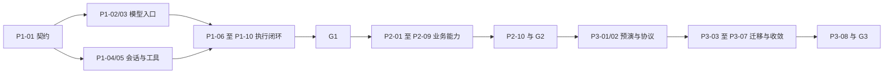

# Multica 单模型内置运行时三阶段改造计划

状态：阶段一 G1、阶段二 G2 的本地假模型验收已通过。阶段三已完成迁移工具、协议约束、三端产品代码收敛、外部 AI CLI 执行实现移除和隔离备份恢复演练；设备与正式安装包验收仍待完成，G3 尚未整体通过。尚未迁移或发布生产环境。最终工程验证见[阶段三验收记录](native-runtime-stage3-acceptance.zh.md)，下方早期验证按日期保留。

### 当前实现与验证边界

- P1-01 至 P1-09 已接入：固定模型传输、逐次运行授权、数据库检查点、租约与版本校验、基础文件/Shell 工具、原生 daemon 注册、聊天和任务接线、取消与恢复。
- P1-10 已接入共享 Web/Desktop 创建与配置组件、固定模型展示和移动端响应解析。浏览器实际验证使用 Web；Electron 和移动端设备界面验收仍留在三端收敛阶段，不能将共享组件测试视为设备验收。
- G1 使用本地 HTTP 假模型、独立 PostgreSQL 开发数据库和当前源码构建的 Multica daemon 验证。没有调用真实付费模型，没有执行外部 AI CLI，没有迁移或发布生产环境。
- 原生模式默认开启，显式设置 `MULTICA_NATIVE_RUNTIME=false` 会报错；文件写入与 Shell 单独显式授权。旧 AI CLI 执行适配器已移除，历史元数据保留。MCP、插件工具、附件输入和产物上传已接入。
- 模型入口已改为 PostgreSQL 共享配额，覆盖执行、摘要、标题和后续建议，SDK 重试逐次计数；G2 按下方验收矩阵通过。历史压缩、追加消息原子持久化、原生业务工具和四类配置管理已有回归证据；Agent Builder 草稿确认创建及 Mika 上手会话的预览、确认、任务执行与交接已用浏览器验证；钉钉文本交付和任务/聊天产物上传已有本地集成证据，其余渠道已补齐本地协议验收，真实渠道账号仍未验收。

验证记录（2026-11-05）：

| 范围 | 已有证据及限制 |
| --- | --- |
| 原生 Go 模块 | `go test -race`：daemon、engine、tools、processtree、agentstate、llm 全部通过；假 HTTP + PostgreSQL 的 `TestNative*` handler 测试通过 |
| 非智能体后端回归 | 管理环境中的 regular Go suite + race 通过；`make test` 的 PostgreSQL 预检固定访问本机 5432，使用管理环境 `env-exec` 运行等价测试 |
| 已有智能体测试 | Cursor 后台进程测试出现 `retain Cursor shell process group: invalid argument`，因此不声明整个 agent suite 通过；未修改旧 Cursor 实现 |
| 共享前端 | core 2224 个测试通过；views 首次运行有插件测试依赖缺失，安装仓库声明依赖后重验失败套件通过；模型组件 13 个测试通过；core/views 类型检查通过，lint 无错误且有已有警告 |
| 移动端 | 独立套件 245 个测试、原生运行时响应解析、类型检查与 lint 通过；未运行模拟器/设备 |
| 浏览器闭环 | `e2e/native-runtime.spec.ts` 通过：独立测试身份和 daemon、无 AI CLI、界面创建、固定模型、文件工具、第二轮历史续聊和磁盘结果检查。需要显式测试二进制与假模型配置，默认不探测用户安装的程序 |
| 数据库与文档 | sqlc 已重新生成，573–576 迁移已在开发数据库执行；`git diff --check` 通过 |

阶段二实现记录：

- P2-01：原生任务/评论/项目读取、评论回复、状态更新沿用 `mat_` 运行身份与现有 API。假模型到真实权限中间件和 SQL 的集成测试验证评论归因、`source_task_id` 和状态 revision。
- P2-02：官方 Go MCP SDK，stdio、Streamable HTTP（JSON/SSE 响应）和旧 SSE；有界分页、参数 schema 本地校验、稳定名称映射、取消和进程树关闭。工具集合在每次运行初始化后固定，不暴露 MCP sampling、资源或提示词；后两项会在上下文中明确提示。
- P2-03：继续使用现有 Remote MCP 工具批准/schema digest、凭据 broker 和插件 hook；Connected Apps 使用现有 claim overlay。仅 daemon 创建的精确 broker URL 获得本机 HTTP 权限；其余 HTTP 端点继续使用出站网络策略。新增原生客户端穿过 broker 与插件 hook 的集成测试；外部真实服务未调用。
- P2-04：独立原生 brief、根规则自动装载、`read_rules` 的目录层级规则与 `load_skill` 的包内按需读取。沿用 skill 可见性规则，禁止禁用技能调用和路径越界；不扫描外部 AI CLI 配置，不执行技能脚本或开启委派。
- P2-05：完整模型/工具消息留在数据库，服务端生成摘要作为上下文投影；保留当前人类请求与系统规则。摘要不能拆分工具组，普通 save 不允许伪造摘要。摘要失败、租约过期和版本冲突不提交投影；压缩后的后续工具调用已有回归。仍采用保守 byte/token 上界估算；总检查点继续受协议大小限制，不能宣称无限历史。
- P2-06：附件读取绑定当前任务或聊天；文本限制为 UTF-8、64 KiB，图片需显式模型能力且受格式/像素/字节预算约束。模型只提交附件 ID，API 注入授权字节。快速创建会自动携带所选上传及来源快照中的图片，捕获图片使用不可变克隆 ID，文本来源文件按需读取；去重后每条输入最多四个附件，超限明确失败。产物使用现有上传授权，文本渠道不提供上传工具，也不声称已交付文件。
- P2-07：native 运行协商追加输入能力；已领取未提交的输入可重新领取。输入检查点与 delivered 回执在同一数据库事务提交；排队取消、提交时取消、工具组安全步骤和重复输入都有回归。运行进入收尾时关闭输入接收，再释放租约。
- P2-08（本地清单通过）：原生提示词保留触发评论、线程、合并输入、自动化 payload、渠道受众和 skill 选择，不序列化任务凭据。新增受当前运行身份约束的上下文读取与任务创建工具。快速创建绑定界面选择字段、默认负责人和 origin，沿用现有创建服务及触发；Agent Builder 和 Mika 创建入口拒绝覆盖部署模型。自动化与智能体响应使用字段白名单，排除 webhook、MCP 和运行时凭据。新增四个固定配置工具，覆盖项目与资源绑定、智能体与技能、小队与成员、自动化与 schedule/webhook 触发器。创建智能体绑定当前原生运行时和部署模型，保持现有预览/确认语义；不提供触发运行、回放、删除或凭据编辑操作。完整覆盖清单见下表。
- P2-09（本地验收通过）：原生任务创建、评论、状态更新、产物上传和四类配置写操作在执行前持久化操作意图；标识绑定工作区、会话、输入和工具调用，摘要绑定实际方法、路径、媒体类型与请求内容。重复请求只返回同参数、同调用的已确认结果；快速创建的操作标识独立于模型 call ID，防止换 ID 重复创建。回执随会话范围、智能体和工作区删除，显式新会话代际重置时清空。回执预算为每会话 4 MiB；结果超过 128 KiB 或无法确认时停止，不能自动重放。
- 写操作的业务提交和回执保存之间仍有故障窗口。窗口内进程退出会保留未知结果，需要业务对账；不承诺 exactly-once。已确认回执可在新租约下恢复 started/unknown 检查点；普通 save 不能自行把 unknown 改成成功。

阶段二追加验证（2026-11-06，管理开发环境，假 HTTP 模型与 PostgreSQL）：

- `-race`：daemon、engine、tools、execenv、agentstate、llm 全包通过；原生 handler、追加消息、Steer、Agent Builder 与 Mika 创建的定向回归通过。
- 快速创建集成穿过真实 task-token 权限中间件和创建服务，验证界面字段、origin、创建者、负责人及运行队列触发；聊天历史和 run-only 自动化读取使用同一闭环验证。
- 写回执回归覆盖执行中重复请求、修改参数、不同工作区、客户端断开后记录回执、不同 call ID 的快速创建、新租约恢复及未知结果不重放。新增 unknown 检查点恢复后，相关 handler/daemon 定向 `-race` 通过。补充已确认 4xx 拒绝恢复为 failed、新会话清理旧回执，以及上传和 webhook 触发器回执排除凭据的回归。
- 配置管理集成用假模型执行 18 步，通过真实 task-token 权限、业务 handler 和 SQL，验证原生运行时绑定、技能、小队成员、自动化触发器、跨工作区拒绝及 14 条持久写回执。参数校验、输出投影和集成 `-race` 通过。
- 真实服务器路由的 `schedule/webhook × run_only/create_issue` 四组合通过 `-race`：创建配置、事件去重、正式领取凭据、启动、原生模型/工具循环、完成回调和正式事件监听器驱动自动化终态。调度从既有计划派发入口进入，webhook 使用真实 ingress 和持久 worker；未访问外部渠道。
- 浏览器使用当前源码构建的原生 daemon、独立测试身份及假模型，验证文件工具续聊、Agent Builder 模型草稿进入配置面板、确认前不创建和确认后仅创建一次。Mika 使用正式创建与 onboarding 开场端点，验证成员开场/时区上下文、`multica-onboarding` skill 装载、预览前零写入、确认后创建项目和 `todo` 任务、正式领取与执行、评论结果、`in_review` 状态及聊天交接。所有模型请求固定为部署模型；未执行外部 AI CLI 或调用真实模型。
- 原生附件响应仅保留元数据和稳定下载路径，上传回执与任务/评论工具历史不持久化下载能力 URL；保留用户正文中的普通 URL 和整数 revision 精度。
- 扩大 regular Go race 首次发现钉钉 reaction 测试在恢复全局 HTTP client 时与无关标题推理竞争；该测试显式关闭标题模型配置后，定向回归通过。修复后扩大 regular Go suite 的 `-race` 全部通过。`go vet ./...` 另发现原生限流锁随 Handler 的请求副本被复制，改为初始化后共享指针；新增副本不能绕过活动运行限额的回归，原生 handler `-race` 和全包 `go vet` 通过。
- `make sqlc` 已重新生成；577 迁移已在独立开发数据库执行。上述原生验证没有调用真实模型或外部 AI CLI。

验证补充（2026-11-06）：

- 原生会话领取先锁定工作区和仍在运行的任务，防止取消或工作区删除之后晚插入会话。新增并发回归先失败后通过；SQL 使用缓存的同版本 sqlc v1.31.1 重新生成，`make sqlc` 的模块弃用元数据查询因网络超时未完成。
- 新增 `multica_record_squad_evaluation`，只向已验证的 issue 队长运行暴露，并沿用现有评价权限、任务归因与写回执。正式领取响应补齐经过当前领导权验证的 squad ID/name。分配、普通评论、@squad、worker 线程回复、子任务完成五条正式路由通过 `-race`，验证 worker 的线程/运行归因、子任务 done 后唤醒队长，以及静默 no_action 只记录一次评价、不发队长评论、不再入队。子任务用例保持父任务可运行，遵循 backlog 暂停既有系统唤醒的规则。
- 快速创建允许读取明确选中的上传和本次输入的不可变来源附件，目标 issue 可继续读取捕获副本，源 issue、未选上传及移动到其他 issue 的上传均不能扩大授权。agent/squad 两条假模型→原生工具→真实服务/SQL 闭环验证创建前后读取、附件绑定、来源附着、picker 字段和单次分配触发。另用正式来源预览与 agent 创建 handler 验证对象克隆、任务上下文归因、修改原对象后读取历史副本，以及拒绝读取原对象。来源相关界面组件的 83 个测试通过；未将这两层证据声明为完整浏览器捕获闭环，二进制文档限制仍然生效。
- 完整 Web 浏览器验收通过：上手向导进入 Mika、文件续聊、Agent Builder 确认、Mika 项目/任务执行与 in_review 交接、摘要卡片预览、daemon 停启、历史恢复、一次上游 503 重试、仅创建一个 09:00 Asia/Shanghai 的摘要计划。验收发现向导未进入工作区路由时模型请求缺少目标工作区，已修复为显式传递目标工作区并隔离模型缓存；core 相关 144 个测试、views 相关 21 个测试、两包类型检查及改动文件 lint 通过。
- 钉钉使用仅本地的 HTTP 假 transport 验证正式 channel ingress→事件去重→正式领取/启动→原生模型→正式完成→渠道文本和 reaction 交付；重复入口和完成回调不重复运行或回复。原有 reaction 回归与新增原生路径均通过 `-race`，没有向真实渠道发送消息。其他渠道和文件交付仍须逐项验证。

- 扩大 regular Go suite 的 `-race` 再次全部通过，包括 handler、daemon、execenv 与 repocache。长套件发现三个旧测试共用运行时心跳过期，已将 quick-create 父级权限、来源上下文生命周期、小队分配触发测试改为各自创建独立运行时并通过定向回归。Git 相关套件使用本机已有 Git 2.50.1；未执行真实 AI CLI。最终改动文件 lint 和 `go vet ./...` 通过。

- 运行中权限撤销的四个 `-race` 用例通过：撤销 daemon 凭据、运行时离线、领取代际变化、会话租约过期均中断已打开的上游流，不交付最终模型结果。实际文件上传处理与假对象存储的三个原生闭环通过：任务产物、聊天产物、纯文本渠道禁用上传；验证文件字节、所属范围、agent/运行归因、单次上传和持久回执。尚未将上传入库视为外部渠道已交付。
- P2-10 基础实现：移除原 API 进程内计数器，统一模型传输为每次上游 HTTP 尝试申请 PostgreSQL 共享并发、最近一分钟请求数及 Token 预算。执行与摘要共享运行互斥，标题和后续建议携带会话/工作区归因。原生和辅助调用及 SDK 重试逐次记账；缺失或无效用量保留预留，缓存输入不重复计费。新增 `MULTICA_LLM_LIMITS_JSON`，配置不合法时启动失败，所有副本须使用相同配置。
- 新账本只保留标识、部署模型名、时序和用量，不记录模型/工具正文或上游凭据；跟随工作区删除并阻止晚插入，完成结算幂等。新增低基数调用、延迟、Token、未知用量、重试、费用估算及工具事件指标，工具事件在消息去重后统计。标题/后续建议失败日志不再输出原始 SDK 错误。运维语义和可导入 Grafana 面板见 [配额与观测说明](native-model-operations.zh.md)。金额仅按已有价格表估算，未设置金额硬上限。
- 共享配额定向 `-race` 验证通过：两个控制器实例并发争用同一工作区限额，跨用途请求/Token 预算、摘要互斥、租约过期恢复、未知用量保留、重复结算和归因缺失拒绝。模型传输回归验证执行/摘要/标题/后续建议及 SDK 重试的逐次记账和合法零用量与未知用量的区分。完整回归结果将在下方补充。
- 小队正式路由原生验收扩展至十个 `-race` 用例：五种既有触发、`action`/`failed` 评价，以及三种评价在服务端提交后响应丢失的恢复。恢复使用新的 API router、原生执行器和空本地 journal，从 PostgreSQL 回执继续执行，不重发评价；重复完成回调不重复评价或最终评论。`failed` 是队长评价结果，不等同于运行执行失败；完成评论继续沿用既有规则。
- 恢复验收发现并修复 JSONB 与 HTTP 编码格式不同造成的回执字符串不一致。统一工具结果编码保留精确整数，同时规范空白、对象键序与 HTML 转义；有先失败后通过的回归。此结论只覆盖已确认的业务回执，不能推导为未知外部写入可重放。
- 小队正式路由验收扩展至十三个 `-race` 用例：模型响应期间更换队长后，旧队长评价被拒绝；取消运行后不再写评价，晚到和重复完成不能覆盖取消或补发评论；先写业务评论再记录 `no_action` 保留一条评论和两条写回执。
- Telegram 使用本地假 transport 和真实本地对象存储，穿过生产 router 的渠道接线、入口去重、正式领取/启动、原生模型及产物工具、完成时附件绑定和渠道交付 worker。`-race` 验证文件字节、文件名、目标会话、单次文本/文件交付和重复完成去重；没有访问真实 Telegram。此证据补齐了一个渠道的文件交付闭环，不代表其余渠道均已验收。
- 原生快速创建的前后端不再要求旧运行时使用的 bundled Multica CLI 版本；来源捕获仍检查显式能力。新增回归先复现界面禁用和服务端 422，再通过普通字段、优先级/日期及正式来源创建测试；共享快速创建组件的 32 个测试、类型检查和相关 lint 通过。来源生命周期清理测试隔离其他 fixture 的待清理行，避免有界 sweeper 被遗留记录占满；定向 `-race` 通过。
- Prometheus 实际采集开发 API，Grafana 浏览器加载全部十个面板，数据源查询均为 HTTP 200，无查询或页面错误；运行、工具、模型和重试有实际数据。假模型未报告用量，不能据此声称真实 Token、费用或上游账单验收完成。临时监控容器已停止。
- 最新扩大回归通过：在暂停开发 API、保留管理数据库的环境中，使用该 checkout 的 Go 和 Git 工具链执行 `scripts/test-go.sh --race --only regular`，全部包通过，包括 handler（321 秒）、正式 server router、daemon、execenv 和 repocache。全包 `go vet ./...`、E2E 文件类型检查和 `git diff --check` 通过。此命令不含旧 `pkg/agent` 套件，未将此前 Cursor 平台错误宣称为已修复。
- 来源捕获的完整 Web 浏览器组合验收通过：评论动作打开来源预览并选择原生智能体，正式创建子任务，假模型收到捕获正文与图片字节，工具仅创建一次。目标快照使用克隆附件 ID 并保留来源 ID；修改源任务后，目标的 Context snapshot 仍显示原正文。该用例同时复验文件续聊、Agent Builder、Mika、daemon 重启及 503 恢复。开发服务器出现一次导航超时，测试分别设置页面导航与控件操作超时后完整通过。
- Connected Apps 正式 router 的两项 `-race` 集成通过：启用时，领取阶段的任务 overlay 覆盖智能体同名旧配置，原生引擎发现并调用假 HTTP MCP 工具，结果回传且只写一次；关闭时不交付任务 overlay 或应用元数据。MCP 凭据、上游凭据、daemon 凭据和集成端点不进入模型请求与持久历史。此测试从入队快照开始，不覆盖真实 Composio 授权与会话创建。
- Slack 正式 router 的原生 `-race` 闭环通过：群聊线程上下文与非私密受众传入模型，回复回到原线程，processing reaction 添加与清理，重复 ingress 和完成回调只产生一次运行与回复。当前 Slack 路径只交付文本，领取与模型工具集合均不承诺文件交付；所有 Slack HTTP 请求由测试 transport 截获。
- 并发隔离 `-race` 集成通过：同一 daemon 在两个工作区同时打开模型请求，使用相同文件相对路径、MCP 服务名、工具名和 call ID，分别读取并修改各自文件、带各自凭据调用各自 MCP，并保存独立数据库会话与历史。两个端点都校验各自凭据，模型与检查点均检查不包含另一运行正文或凭据；本地 journal 目录共用以验证记录身份隔离。
- API 重启的长流恢复 `-race` 集成通过：文件写入结果已保存后，关闭 API 的 TCP 监听器及活动连接，中断正在输出的模型流，确认上游取消、运行未误报完成。重建 API router 和原生 backend、使用空 journal 并模拟租约到期后，从同一 PostgreSQL 会话继续；最终只有一组文件调用/结果，未重复写入或保存半截回复。这里重建的是监听器与路由，并未将其描述为真实生产进程崩溃演练；业务已写但回执未提交的未知窗口仍需对账。
- 加入上述集成后，`go test -race ./cmd/server -count=1` 整包通过（33.690 秒），`go vet ./cmd/server`、浏览器测试与夹具的 TypeScript 检查、`git diff --check` 通过。该轮仅扩大到 server router 包，未重跑或扩大声称旧智能体套件的结果。

- 飞书正式 router 的原生 `-race` 闭环通过：群聊受众进入模型，回复携带发起者 mention 并回到原线程，processing reaction 添加和清理；重复入口与完成回调只运行、回复一次。使用真实飞书 HTTP client 连接本地假服务，验证应用凭据和 tenant token；现有飞书文本能力边界与 Slack 专属 `chat_in_thread` 契约保持一致。
- 企业微信原生文件交付 `-race` 闭环通过：现有渠道 Factory 用本地真实 WebSocket 接收两次相同 callback，与正式 router 共用发送器注册表；只创建一次运行，最终回复关闭原先流式气泡，原生产物通过真实本地对象存储和 `aibot_upload_media_init/chunk/finish`、`aibot_send_msg` 协议发送一次。验证文件字节、文件名、目标会话、回复先于文件以及服务端 ACK；测试等待交付指标确认并关闭两端 socket，没有访问真实企业微信。
- Connected Apps 扩展至七项 `-race` 用例：保留两项领取快照测试，新增正式任务创建入口 → 入队前真实 Composio Service/SDK → 本地假 session API → 持久 MCP overlay → 正式领取 → 原生 MCP 调用闭环。智能体所有者与发起者为不同成员，只使用所有者有效且允许的账号；发起者账号和未选择工具包不能进入会话。开关关闭、连接撤销或不在白名单时不创建 session；调用权限不足返回 403，零运行、零 session。真实 Service/SDK 通过既有字段注入，未将此证据描述为生产启动接线或真实 OAuth 授权验收。
- 长会话压缩的正式 router `-race` 闭环通过：数据库预存完整历史工具组，原生 backend 自动调用正式摘要入口，摘要与执行均使用部署唯一模型；压缩后继续文件读取并将结果交给下一次推理。验证历史资源标识、当前系统约束与用户请求保留，调用/结果成组，完整旧工具输出仍在数据库，新的工具组只执行一次。结构与原子性由可控假模型验证，真实模型摘要质量仍需单独评测。

- 本轮扩大验证：`go test -race ./cmd/server -count=1` 整包通过（28.127 秒）；engine、agentstate、mcpclient 全包 `-race`，handler 的摘要原子性、三类历史/回执删除、工作区清理及四种流中权限撤销定向 `-race`（11.422 秒），以及 `go vet ./cmd/server` 通过。新增场景使共用工作区累计预留接近默认每分钟 Token 上限；小队每个场景改用独立工作区并清理账本，公共 fixture teardown 也在删除工作区前清理模型账本。失败的整包复现确认是配额按预期拒绝请求，修正测试隔离后整包通过；未放宽生产限额。本轮未改前端、未重跑浏览器与旧智能体套件。

P2-08 功能覆盖清单：

| 功能 | 当前证据 | 未完成范围 |
| --- | --- | --- |
| 快速创建任务 | 假模型 → 原生工具 → 真实授权/服务/SQL；agent/squad picker、归因、分配触发、已选上传与不可变来源附件读取/绑定；完整 Web 来源预览、图片输入、单次子任务创建及历史快照界面验证通过 | 二进制文档限制仍适用；不代表 Electron/设备验收 |
| 自动化运行 | schedule/webhook × run_only/create_issue 的正式路由、凭据领取、原生 backend、终态监听与去重通过 | 调度时钟与重试由既有 scheduler/service 测试负责；真实通知及生产重启演练留至 G3 |
| Agent Builder | 固定模型校验、会话创建/切换回归，浏览器验证原生模型草稿、配置面板、用户确认和单次创建 | Electron 窗口与设备验收留到三端收敛 |
| Mika | 固定模型、规则/skill、四类配置工具及 18 步配置闭环；完整浏览器向导、确认创建、任务交接、定时摘要、daemon 重启和 503 重试通过 | Electron/设备和其余故障组合留到后续验收；不宣称功能等价 |
| 聊天与外部渠道 | 当前会话身份读取、历史游标、受众/附件能力提示；钉钉文本/reaction；Telegram 原生产物上传与文本/文件交付；Slack/飞书原生群聊线程回复、reaction 和文本能力约束；企业微信本地 WebSocket 的流式回复与文件交付；上述入口/完成去重通过 | 协议断线/交付失败/重启由既有渠道测试负责；真实渠道连接和设备验收仍未进行 |
| 小队已有触发 | 原生 squad picker；分配、普通评论、@squad、worker 线程回复、子任务完成；三类评价、响应丢失后的恢复、完成去重、队长更换、执行取消及业务评论交错，共十三个正式路由用例通过，未增加引擎委派 | 已列出的触发与组合通过；不增加新委派策略 |

G2 收尾验证（2026-11-06）：`scripts/test-go.sh --race --only regular` 全部通过，其中正式 router 33.066 秒、handler 146.580 秒。Connected Apps 新增第八项用例，通过环境配置和正式 router 构造服务，验证 handler 与入队服务共享同一实例，并完成原生 MCP 调用。SDK HTTP client 显式注入本地 transport，测试不依赖全局传输替换。新增 issue/chat/builder 删除期间的打开流测试：正式删除入口清理会话、取消上游，late 推理返回 403，历史不重建。旧 Cursor agent suite 未重跑，不宣称此前的平台错误已修复。

[G2 验收矩阵](native-runtime-acceptance.zh.md) 给出逐项 canonical 测试、渠道协议故障和受支持边界。G2 按本地可控环境通过；MCP sampling/resources/prompts、二进制文档解析仍未实现，真实 OAuth、真实渠道与真实模型质量未验收。Electron/移动设备与生产切换演练继续留在第三阶段。

后续变更继续追加对应验证结果；这里的通过记录仅覆盖列出的范围。

目标：由 Multica 自己执行智能体循环，所有模型请求使用部署指定的唯一 LLM API 和模型，最终移除对外部 AI CLI 的依赖。

## 目标与实施约定

- 保留 API 服务、守护进程、运行队列、业务权限、工作目录、消息上报和客户端展示体系。
- 智能体循环和本机工具运行在守护进程中；模型密钥由 API 服务持有，通过经过授权的模型调用入口访问上游。
- 自动标题、后续提问和智能体执行共享唯一模型配置；各用途可以有不同的超时、输出预算和推理参数。禁止请求覆盖模型、上游地址、认证头或自动切换模型。
- 移除的是外部 AI CLI。Shell、Git、构建工具和 stdio MCP 仍可以作为工具子进程执行，统一受工具权限和生命周期管理。
- 实施、研究、审查和验证均由主智能体串行完成。内置引擎首版采用单执行循环，不增加模型调度、子智能体或新的自动委派能力。
- 三阶段在同一目标架构上递进。新执行链不回退到外部 AI CLI，不双写会话，不为内部代码新增旧协议适配层。历史运行仍可读取；已安装客户端的响应兼容按仓库规则维护。
- 开发与自动验证默认使用可控的模型 HTTP 假服务；真实模型质量评测和生产切换单独记录环境、成本与执行结果。

文中“任务”指 Issue，“运行”指一次 Run（API / DB 中的 `task`）。任务编号 `P1-*` 等是工程工作项编号。

## 代码基线与复用范围

| 现有位置 | 当前职责 | 规划处理 |
| --- | --- | --- |
| [agent.go](../../server/pkg/agent/agent.go) | `Backend.Execute`、`Session`、`Message`、`Result` | 作为初始接入接口；最终收敛为内置执行契约，删除专属 CLI 字段 |
| [daemon.go](../../server/internal/daemon/daemon.go) | 环境准备、Backend 构造、执行流消费、取消和结果上报 | 提取内置执行接线；保留调度与上报能力 |
| [client.go](../../server/pkg/llm/client.go) | 服务端辅助 LLM 调用、SDK 封装、默认模型 | 扩展为唯一模型传输模块，更新调用者与 SDK 导入约束测试 |
| [execenv](../../server/internal/daemon/execenv/) | 工作目录、worktree、上下文及提供方配置 | 复用通用目录准备，逐步移除提供方配置注入 |
| [task.go](../../server/internal/service/task.go) | 入队、运行状态、最终结果与业务协调 | 保留业务语义；接入新的会话与恢复信息 |
| [daemon.go](../../server/internal/handler/daemon.go) | 领取授权、任务身份、会话指针与回调 | 增加内置执行所需的受限端点和能力协商 |
| [remote_mcp_broker.go](../../server/internal/daemon/remote_mcp_broker.go) / [plugin_hook_mcp.go](../../server/internal/daemon/plugin_hook_mcp.go) | Remote MCP、插件工具和凭据隔离 | 复用工具授权与路由；补齐内置 MCP 客户端 |
| [core](../../packages/core/) / [views](../../packages/views/) | 类型、响应解析、查询、运行时与智能体配置 | 增加内置能力，再收敛模型和运行时选择 |
| [mobile](../../apps/mobile/) | 独立客户端 | 同步协议与产品语义，保持独立数据层、UI 和验证 |

新增目录名称是建议，实施时可按仓库模式调整；功能归属与验收要求不随名称调整而改变。

## 目标执行链

模块职责：

- 模型传输模块：构建上游请求，固定模型，解析文本、工具调用和用量；不执行工具。OpenAI SDK 类型保留在 `pkg/llm` 内，向调用方提供项目自有类型。
- 内置引擎模块：装载上下文、推进执行循环、保存检查点、产生统一事件；对调用方提供小接口，避免将每种工具的细节扩散到 daemon。
- 工具模块：提供描述与参数 schema，校验权限并执行工具；管理输出、取消和子进程。首版只建立实际需要的实现与测试注入接口。
- 会话模块：管理会话版本、执行租约、消息及工具记录；不把展示用 transcript 当作可恢复的模型历史。

## 阶段一：最小可用闭环

交付目标：在没有安装任何外部 AI CLI 的机器上，完成新建智能体、聊天续聊、任务执行、受限文件修改与命令执行，并在界面看到结果。

本阶段包含基本权限、持久化和不确定工具结果处理。自动化、全部 MCP 类型、多模态和高阶上下文压缩在阶段二补齐；阶段一不宣称功能完全等价。

| 编号 | 工作项 | 主要交付物与代码范围 | 依赖 | 验收标准 |
| --- | --- | --- | --- | --- |
| P1-01 | 固定执行契约与模型能力 | 模型传输、引擎、工具、会话的类型与不变量；模型协议样例和能力清单 | 无 | 明确流式文本、工具调用、JSON 输出支持情况；明确最大上下文、工具参数和用量语义；未知能力不靠模型名称猜测 |
| P1-02 | 唯一模型配置和传输模块 | `pkg/llm`；配置解析、启动校验、辅助生成调用者和约束测试 | P1-01 | endpoint、模型只有一个配置源；未配置时模型层不发送请求，运行给出可恢复的配置错误；辅助功能和引擎不继承彼此的推理/超时策略 |
| P1-03 | 受限模型调用入口 | daemon 客户端、handler、路由、流式项目协议 | P1-02 | 服务端逐次校验工作区、运行身份、执行所有权及运行状态；拒绝模型/地址/认证覆盖；限流、请求大小和断连取消有效；密钥不进入 daemon、日志或模型历史 |
| P1-04 | 会话及工具执行记录 | 会话/消息/工具记录迁移、sqlc 查询、检查点端点与仓库模块 | P1-01 | 以工作区、智能体和业务会话隔离；记录版本、工具调用 ID、参数摘要、执行状态和结果；并发写由执行租约与版本校验防重；无数据库外键，索引独立并发迁移 |
| P1-05 | 基础工具宿主及权限 | 建议 `internal/daemon/tools/`：读文件、列目录、文本搜索、应用补丁、运行命令 | P1-01 | JSON 参数校验；路径规范化及符号链接约束；受控工作目录；超时、输出截断、取消和进程树回收；Shell 与网络权限明确，目录隔离不被称为完整沙箱 |
| P1-06 | 内置执行循环 | 建议 `internal/daemon/engine/`；通过 `Backend.Execute` 接入 | P1-02、P1-04、P1-05 | 聚合完整工具参数后才执行；工具结果按 ID 配对；工具错误可回传模型；限制轮数、输出及上下文；相同会话只有一个活动执行者 |
| P1-07 | 内置运行时注册与接线 | daemon 注册/心跳、环境准备、Backend 工厂与能力报告 | P1-03、P1-06 | 不查找 AI CLI 也可注册和领取；缺失模型配置有明确健康状态；无运行时默认模型覆盖和 CLI 回退 |
| P1-08 | 聊天和任务执行接入 | prompt 构建、上下文注入、聊天结果、任务运行终态 | P1-07 | 基础平台说明直接进入引擎上下文；聊天和任务均能完成工具循环；运行 completed 不被误作任务 done；保留归因、可见范围和触发语义 |
| P1-09 | 取消、重试和最小恢复 | 检查点恢复、工具状态协调、daemon watchdog 与终态回调 | P1-04、P1-06、P1-08 | 已完成工具结果可重用；执行中断且结果未知的写操作不会自动重放；取消后工具退出；重复终态回调不重复回复；模型流中断不自动重放整个有副作用的运行 |
| P1-10 | 客户端最小闭环及阶段验收 | core schema/类型、共享运行时显示、最小配置入口；移动端响应兼容 | P1-07、P1-08、P1-09 | Web/Desktop 可创建并使用内置智能体；固定模型可识别；移动端可解析新响应并展示运行；模型假服务完成下述 G1 验收 |

阶段一中的平台操作可先使用现有 `multica` CLI，限定为工具宿主中的受控命令；阶段二由原生业务工具接管。此安排不重新引入外部 AI CLI。

### G1：阶段一完成条件

- [x] 将全部外部 AI CLI 设为缺失路径，内置运行时仍可注册、上线、领取并执行。
- [x] 假模型先要求读取文件、再要求修改文件、最后输出结果，界面事件和磁盘内容一致。
- [x] 同一聊天第二轮能读取上一轮模型和工具上下文；服务端拒绝跨工作区、跨会话读取。
- [x] 取消运行后没有遗留工具进程；不因电脑休眠误算通用无活动时间。
- [x] 覆盖“写入已发生、保存结果前中断”，恢复显示结果未知且不重复执行。
- [x] 流式请求取消、未授权请求、模型覆盖、上游 401/429/5xx、缺失模型配置均有确定行为。
- [x] 自动标题、后续提问和运行请求使用同一模型；关闭配置时不发生意外上游请求。

G1 证据分别位于原生 HTTP/数据库集成测试、浏览器测试、工具进程树测试、已有休眠时钟回归和共享模型客户端测试中。已观察到的工具结果先写本地待上报文件再提交数据库；结果无法确认时保留未知状态并阻止继续执行。真实模型的工具调用质量不属于假服务验收结论。

## 阶段二：业务能力与可靠性补齐

交付目标：覆盖平台业务工具、现有集成、长会话、附件和自动化，形成可持续运行的内置引擎。

| 编号 | 工作项 | 主要交付物与代码范围 | 依赖 | 验收标准 |
| --- | --- | --- | --- | --- |
| P2-01 | 原生 Multica 业务工具 | 读取任务/评论/项目、回复、修改状态等；共享现有业务服务 | G1 | 工具使用运行身份和发起者授权；所有关联查询包含工作区；保留触发、归因、评论交付等业务副作用；不绕过服务层直接写库 |
| P2-02 | 原生 MCP 客户端与工具映射 | stdio、HTTP/Streamable HTTP，以及兼容清单中仍使用的传输；连接生命周期 | G1 | `initialize`、工具分页发现、工具调用、取消和关闭完整；工具名称无冲突；schema 与结果类型有映射；不支持的资源/提示词能力明确报告 |
| P2-03 | 接入现有 MCP 与应用集成 | 工作区/智能体 MCP、Remote MCP、插件 hook、Connected Apps | P2-02 | 继续使用凭据解析、工具批准集合、网络策略和 required/optional 失败规则；配置覆盖优先级确定；本机 broker 不被公共 HTTPS 策略误拒 |
| P2-04 | 项目规则与 skill 装载 | 通用 brief、仓库规则、skill 清单/按需加载、项目资源 | P2-01、G1 | 规则优先级和信任来源明确；不依赖某 CLI 自动扫描；禁用的 skill 不暴露；权限和执行前提可见；不自动启用子智能体 |
| P2-05 | 长会话与上下文预算 | Token 预算、输出截断、历史压缩、摘要检查点 | P1-04、G1 | 请求前保留输出余量；压缩不拆散工具调用与结果；摘要仍使用唯一模型；压缩失败保留原会话，可说明原因并重试 |
| P2-06 | 附件与产物 | 模型输入媒体、文档读取、产物上传和渠道交付 | G1 | 先校验所选模型能力及媒体限制；不支持的格式有明确处理；访问沿用任务授权；下载链接、图片和文件结果不误当普通工具字符串 |
| P2-07 | 执行中追加消息 | `Session.Supplement`、输入领取、检查点与工具阶段协调 | P1-09、G1 | 只在安全步骤装入新输入；中断、取消和流断开不会使已领取输入丢失或重复；返回是否真正接受追加消息 |
| P2-08 | 自动化与外部渠道 | 自动化、quick-create、智能体构建、Mika、聊天渠道及现有小队触发路径 | P2-01、P2-03、P2-04、P2-06、P2-07 | 对照现有功能清单逐项验证；保留外部事件去重、评论线程和渠道交付规则；不扩展既有自动委派策略 |
| P2-09 | 工具授权与写操作恢复 | 工具能力授权、原生写操作幂等键、结果协调、数据保留/删除 | P2-01、P2-03、P1-09 | 权限不足在执行前拒绝；幂等键绑定工作区/操作/参数；外部写入结果未知时不承诺 exactly-once；已有确认流程继续生效，新审批界面仅在确定产品需要时引入 |
| P2-10 | 可观测性、限流及阶段验收 | 调用延迟、Token/费用、重试次数、活动工具、并发配额和脱敏日志 | P2-05、P2-08、P2-09 | 运行与辅助调用可归因且不重复统计；限流覆盖全部 API 副本；单模型用量总预算包含摘要；完成 G2 验收 |

### G2：阶段二完成条件

- [x] 原生业务工具与原有操作具有相同权限和副作用，业务工具不依赖 `multica` CLI。
- [x] stdio MCP、远程 MCP、插件 hook 和 Connected Apps 按功能清单验证；不支持项记录为未完成。
- [x] 长会话压缩后仍能继续工具调用，不出现孤立工具结果或丢失用户约束。完整原生 backend → 正式摘要 API → 工具 → 后续推理闭环、摘要原子性/失败保留与工具组边界测试通过；此项为本地假模型结构验收，真实模型摘要质量另行评测。
- [x] 断网、API 重启、daemon 重启、执行租约过期和重复回调后均可解释并恢复状态。
- [x] 覆盖执行中追加消息、附件、产物、自动化与渠道回复。
- [x] 并发运行不能串用会话、工作目录、工具凭据或他人运行权限。两个工作区同 daemon 的并发原生工具/文件/会话集成和已有运行身份、跨范围拒绝回归通过；不据此声称 Shell 是完整操作系统沙箱。
- [x] 仪表盘能分别观察运行、工具和模型调用；异常无凭据和私密正文泄露。十面板的本地浏览器与真实采集验证通过，错误脱敏有定向回归；真实模型用量/费用未验收。

## 阶段三：迁移、收敛与移除 AI CLI

交付目标：新安装与已有部署都能切换到内置运行时，所有产品入口和发布产物均不再依赖外部 AI CLI。

| 编号 | 工作项 | 主要交付物与代码范围 | 依赖 | 验收标准 |
| --- | --- | --- | --- | --- |
| P3-01 | 存量盘点与迁移预演 | 运行时/智能体/会话/自定义 profile/集成配置报告，dry-run 工具 | G2 | 不修改数据即可列出可迁移、需重新配置和不可续接项；明确目标机器、owner 和运行时可见范围；统计活动与排队运行 |
| P3-02 | 协议与发布顺序 | API/daemon 能力协商、最低受支持版本、旧客户端写入行为 | P3-01 | 新 API 响应保持已安装客户端兼容；旧请求的禁用模型/CLI 配置返回明确错误；旧 daemon 无法被分配内置运行；不依靠客户端隐藏实现约束 |
| P3-03 | 运行时、智能体和会话迁移 | 可重跑迁移工具、绑定更新、排队运行协调与审计报告 | P3-01、P3-02 | 活动运行先排空，切换期间阻止旧执行器新领取；维护本机目录/owner/visibility；排队运行有迁移或终结规则；外部会话不伪装成可原地恢复 |
| P3-04 | Web/Desktop 产品收敛 | core 类型/schema、views、平台接线、onboarding 与运行时管理 | P3-02、P3-03 | 不再提供 AI CLI 路径/版本/专属参数或任意模型输入；机器选择保留；错误、用量和历史展示完整；所有受支持翻译同步 |
| P3-05 | 移动端产品收敛 | 移动端独立 schema、查询、配置和展示 | P3-02、P3-03 | 与 Web/Desktop 语义一致；独立验证响应解析、导航、断线重连和固定模型展示；原生界面通过模拟器/设备验证 |
| P3-06 | 移除 AI CLI 实现 | 发现/探测、适配器、专属会话目录、profile 启动配置及依赖清理 | P3-03、P3-04、P3-05 | 生产执行路径无 AI CLI 查找、启动或回退；保留通用进程树管理和工具子进程；历史 provider/model 只作为历史数据展示，不保留执行适配层 |
| P3-07 | 部署、文档及开发规范 | 环境变量、Compose、CLI setup、Desktop 打包、CI、站点文案与必要规范更新 | P3-02、P3-06 | 新安装只需 Multica、模型配置和必要工具；缺失配置有明确引导；不自动安装 AI CLI；变更的工作流在同一变更更新对应说明 |
| P3-08 | 迁移演练与发布候选验收 | 迁移前后对账、备份恢复演练、全链路验证、发布清单 | P3-03 至 P3-07 | 完成 G3；发布候选可审查；真实生产迁移及发布作为后续明确操作，不由规划自动执行 |

P3-01 实现记录（2026-11-06）：新增 `server/cmd/native-migration` 只读命令和 `server/internal/nativemigration` 模块，按单工作区的 PostgreSQL repeatable-read/read-only 快照盘点运行时、智能体、profile、原生/旧聊天/旧运行与已退役会话引用、队列、集成和本机项目目录。候选要求机器/owner/visibility 相同且目标唯一在线；活动运行单列为排空项，CLI 配置和模型覆盖列为重配项，旧会话明确不能原地续接。只查询白名单投影，不读取或输出原始配置、外部会话标识与历史正文。P3-01 最初只读；P3-03 后默认仍为 dry-run，显式写入动作按下文执行。

P3-01 的两个包 `go test -race -count=1` 通过：数据库 fixture 验证数据前后对账、跨工作区隔离、活动/排队/延迟计数、旧/原生/退役会话分类和凭据排除；并发写入验证同一只读快照；CLI 验证参数拒绝和结构化 JSON 输出。全包 `go vet ./...` 通过。[使用说明及边界](native-runtime-migration.zh.md)。尚未执行迁移写入、CLI 删除或生产发布；P3-03 至 P3-08 继续按依赖推进。

P3-02 实现记录（2026-11-06）：新增 `native-runtime-v1` 与最低原生协议版本 1，daemon 检查请求所提供的原生运行时及注册响应的能力/协议范围；旧 API 返回未知 provider 或遗漏运行时也明确拒绝。API 保留注册响应原有字段，新增协议元数据；原生注册预校验、HTTP 单条/批量和 WebSocket 领取、启动同时约束请求能力与持久化注册能力，兼容性拒绝发生在队列修改及凭据生成之前。原生启动必须带领取代次时间戳，并校验机器 token；普通智能体新增/修改禁止非空 CLI 参数，重绑须显式清除遗留配置与模型覆盖。这是 P3-02 过渡实现的行为；阶段三最终构建已禁止旧运行时领取和启动，混合批次只领取兼容的原生任务。[API 优先升级、daemon 重注册及后续切换顺序](native-runtime-migration.zh.md#协议和升级顺序p3-02)。实际最低发行版本由后续发布候选记录，本阶段使用能力协商，不凭尚未发布的版本号放行。

P3-02 回归中修复了来源附件清理的单条领取 SQL：PostgreSQL nested-loop 计划可能反复执行 `LIMIT 1` 子查询，一次把多条对象意图标为已领取，但调用方只收到一条。改用 `MATERIALIZED` 候选集，并重新运行 `make sqlc`；强制该合法查询计划的最小回归先复现失败，修复后与原始附件生命周期测试一同通过 `-race`。重启夹具同时模拟会话租约和模型调用配额租约到期，连续三次 race 验证通过，生产租约校验没有放宽。

P3-02 验证（2026-11-06）：在 checkout 管理环境执行 `env GOFLAGS=-p=1 bash scripts/dev-env.sh exec -- bash scripts/test-go.sh --race --only regular`，76 个有测试的包全部通过，其中 66 个复用缓存。本次重新执行的正式路由包 28.086 秒、daemon 19.221 秒、handler 139.746 秒、service 32.649 秒；`go vet ./...`、文档相对链接和 `git diff --check` 通过。验证期间暂停本地 API，使用隔离开发数据库与假服务；未调用真实模型或真实渠道。本次不包括旧 `pkg/agent` 套件，前述 Cursor 进程组失败未重验；也未重跑前端、移动端或设备验收，不能据此声明完整 `make test` 或 G3 通过。

P3-03 实现记录（2026-11-06）：新增 `585_native_migration_gate` 工作区迁移状态和数据库领取屏障；`server/cmd/native-migration` 现在支持 `inventory`、`status`、`drain`、`apply`、`resume`，写入动作必须显式关闭 dry-run 并使用 operation ID。`drain` 允许已派发运行完成，阻止旧 HTTP/WS daemon 的新领取；`apply` 在同一事务内重验活动运行、原生会话与模型调用租约、目标 daemon 的 `native-runtime-v1` 能力、机器/owner/visibility 和排队绑定，然后迁移智能体与 queued/deferred 运行，清除 CLI 配置并标记原生新会话。迁移回执只保存 ID、状态、时间和数量，旧会话、历史消息、目录、custom_env、MCP 与权限保留；失败回滚，重复 operation ID 可重试。`server/internal/nativemigration` 的 race 集成测试覆盖排空屏障、活动运行阻断、配置明确清除、队列迁移、跨工作区隔离、历史和目录保留、无秘密回执以及重复执行。

P3-04 至 P3-08 工程验收：三端固定模型界面、原生默认注册、外部 AI CLI 执行适配器移除、历史数据访问、安装文档、Docker 迁移工具与 Windows/macOS 原生 CI 已收敛。全量回归中修复原生运行说明未传入模型的问题，新增运行级回归先失败后通过。详细结果和发布前剩余项目见[阶段三验收记录](native-runtime-stage3-acceptance.zh.md)。

### G3：阶段三完成条件

- [ ] 干净环境未安装 AI CLI，能完成部署、创建智能体、聊天、任务、自动化和 MCP 全流程。
- [x] 隔离数据库夹具已完成迁移与恢复对账，覆盖权限、队列、历史、目录和产物；真实部署对账须在维护窗口逐环境执行。
- [x] 旧 AI CLI 会话继续以历史记录展示；恢复需要新会话时明确说明，整理上下文不能声称完整复制旧工具历史。
- [ ] Web、Desktop、Mobile 都完成固定模型和内置运行时流程验证，旧客户端兼容有测试证据。
- [x] 源码生产执行路径、安装入口和已交叉编译的 daemon 不再发现或执行外部 AI CLI；正式安装包仍须发布候选验收。
- [x] 隔离备份恢复演练通过，运维流程要求明确维护窗口；发生新的原生写入后，不允许无条件降级并重放旧队列。

## 顺序、拆分和里程碑

任务表是依赖关系，不是并行智能体调度计划。主智能体按照依赖串行推进；一个工作项过大时拆成多个原子 conventional commit 和可单独审查的 PR。

| 里程碑 | 工程工作项 | 可审查结果 |
| --- | --- | --- |
| M1 | P1-01 至 P1-05 | 模型协议、工具权限、会话模型与可运行的假服务测试 |
| M2 | P1-06 至 P1-10 | 无 AI CLI 的聊天和任务闭环，G1 通过 |
| M3 | P2-01 至 P2-10 | 集成、恢复与长会话覆盖，G2 通过 |
| M4 | P3-01 至 P3-05 | 迁移预演报告、协议发布顺序和三端产品流程 |
| M5 | P3-06 至 P3-08 | AI CLI 移除、干净部署与迁移演练，G3 通过 |

先完成 P1-01 的模型协议样例和工具循环验证，再估算工期。模型工具调用质量、现有 MCP 传输覆盖、移动端原生验证条件和存量配置规模尚未验证，不在本计划中承诺日历日期。

## 关键设计问题及建议默认值

这些问题在对应工作项落实并记录选择；规划阶段采用建议默认值推进，不为每个例行实现选择重复请求确认。

| 问题 | 建议默认值 | 落实位置 |
| --- | --- | --- |
| 模型请求在哪里发送？ | API 服务统一访问上游；daemon 只持有运行身份；首版针对一个明确协议实现 | P1-01、P1-03 |
| 指定哪个模型和 endpoint？ | 由部署配置提供，规划不猜测具体厂商或模型；开发用固定假模型验证 | P1-01、P1-02 |
| 会话真实来源在哪里？ | PostgreSQL 为权威存储；daemon 在每个有副作用步骤前确认检查点已保存，保存结果后再进入下一模型步骤 | P1-04、P1-09 |
| API 不可达时是否继续执行？ | 不开启新的模型步骤或副作用工具；已在执行的工具按取消/超时收尾，结果通过持久化待上报记录协调 | P1-09 |
| 如何处理调用已执行但结果未知？ | 使用持久化操作 ID 和可查询结果；无法确认的外部写入转为待处理状态，禁止盲目自动重试 | P1-09、P2-09 |
| 本地文件和 Shell 如何授权？ | 以任务目录和已授权项目目录为资源范围；Shell 权限单独配置，禁止把字符串命令黑名单当安全沙箱 | P1-05 |
| 单模型是否意味着串行处理全部运行？ | 不意味着；保留现有运行并发限制，新增共享模型配额；同一会话串行，独立会话可并发 | P1-06、P2-10 |
| 是否保留旧运行时自动回退？ | 不保留；按阶段三的排空、迁移和备份恢复方案处理 | P3-03、P3-06 |
| 旧会话能否完整迁移？ | 不作通用转换承诺；保留历史，必要时以可读上下文建立新会话 | P3-01、P3-03 |

## 验证计划

每个行为只设置一个主要测试层。模型协议和工具执行故障在模块接口验证；组件测试验证接线、可访问性和产品流程，避免重复覆盖同一解析矩阵。

| 范围 | 核心验证 |
| --- | --- |
| 模型协议 | 分片工具参数、多工具调用、缺失 usage、截断、非法 JSON、上游错误、取消、唯一模型约束 |
| 工具 | 路径穿越/符号链接、工作目录、输出限额、命令超时、进程树清理、权限不足和结果未知 |
| 会话与数据库 | 工作区隔离、执行租约/版本冲突、完整工具配对、重复保存、结果未知恢复和清理权限 |
| API 与任务服务 | 运行身份授权、撤销权限、取消竞态、重复回调、排队输入、发起者归因和状态副作用 |
| MCP 与集成 | 连接失败策略、工具批准集合、凭据隔离、名称冲突、分页、传输断开和关闭 |
| 客户端 | malformed 响应 fallback、未知枚举、内置运行时、固定模型、pending/retry、历史和重连 |
| E2E | 使用 `TestApiClient` 建立夹具，串联假模型、daemon、基础工具和三端相关流程 |
| 迁移 | dry-run、可重跑、活动运行排空、排队运行对账、保留权限和备份恢复 |

实施中运行最窄的有效检查；里程碑按影响面执行以下仓库检查，实际命令以当时的 Makefile 和 workspace 清单为准：

- Go 与数据库：`make sqlc`（SQL 变更后）、`make test`。默认测试使用假服务/假命令，不解析或执行用户安装的 AI CLI。
- Web/Desktop：`pnpm typecheck`、`pnpm lint`、`pnpm test`。
- E2E：`pnpm exec playwright test`；组合验证可使用 `make check`，避免无变更重复执行同一套检查。
- Mobile：`pnpm --filter @multica/mobile typecheck`、`pnpm --filter @multica/mobile lint`、`pnpm --filter @multica/mobile test`；界面另做模拟器/设备及跨客户端重连验证。
- 文档：相对路径/引用检查和 `git diff --check`。生产代码测试不能代替模型质量评测或原生界面验证。

每次交付记录实现的工作项、测试证据、未完成范围和已知限制。只有阶段完成条件全部满足，才标记 G1/G2/G3 通过。

## 下一步

P3-04 至 P3-07 的代码收敛已实现，P3-08 的自动化验收和隔离备份恢复已执行。当前状态、证据和未完成的设备／发布条件统一见[阶段三验收记录](native-runtime-stage3-acceptance.zh.md)。G3 仍按全部条件判断，不以单元测试替代 Mobile 设备或安装包验收；当前不执行生产切换。
